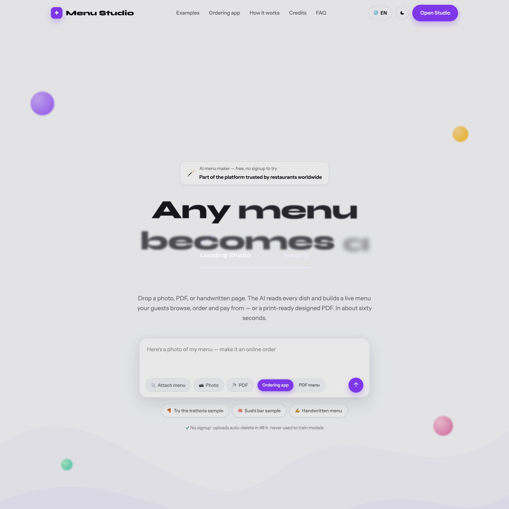

# Menu Studio (AI design studio)

Menu Studio is a public AI design tool for turning any menu — a photo, a PDF,
a handwritten page, or plain pasted text — into a designed, print-ready menu.
It needs no signup: you get a temporary guest session, try everything, and
only sign in if you want to publish the result as a live online-ordering menu
on the platform.

Open it at `/studio` on the main website (the studio workspace itself lives at
`/studio/app`). Nothing you upload is kept long-term: your session and all its
files auto-delete 48 hours after the session is created, and you can delete
everything immediately at any time with **Delete everything now**.

Menu Studio is separate from the in-dashboard [AI menu
generator](ai-menu-generator.md), which builds menus directly inside your
existing restaurant. Studio is the public, design-focused version of the same
idea, and it can hand its result over to the platform when you are ready.

## Bring your menu

In the composer at the bottom of the studio, either:

- **Attach a menu photo or PDF** — photos (PNG, JPG, WEBP, up to 8 MB each,
  up to 10 at once) or a PDF, whose pages are rendered to images in your
  browser before upload. A page that cannot be read is skipped; the rest still
  go through.
- **Paste the menu text** straight into the composer.
- **Try it with a sample menu** if you just want to see how it works.

The AI reads every dish into a draft: categories, items, descriptions, and
prices. Items with a missing price are counted and highlighted so you can tap
the price field and fix them, and prices that look unusual (below 0.10 or
above 10,000) are flagged for review.

Reading your menu is metered against the same shared AI usage as the rest of
the platform. If the AI service is busy the studio tells you to try again and
does not charge you.

## Edit the draft

The extracted draft is fully editable in place — item names, descriptions,
prices, and category names. Edits autosave to your session, and **Undo**
restores the version before your last save or bulk change (one step of
history).

Two bulk commands are built in:

- **Adjust all prices** — raise or lower every price by a percentage.
- **Tag dietary** — automatically tag items as vegetarian, vegan, spicy,
  contains nuts, or gluten-free based on keywords in their names and
  descriptions. Review the results; it is a fast keyword pass, not a full AI
  analysis.

## Menu templates

**Choose a template** opens a gallery of seven built-in designs: classic
bistro, modern minimal, chalkboard, fine dining ornate, cafe pastel, street
food bold, and dark luxury. Pick one and your draft renders into it as a live
preview.

Previewing and customizing is free, and the preview re-renders as you edit:

- **Page size** — A4, Letter, Square, or Story. A4 and Letter export as PDF;
  Square and Story export as PNG for social posts.
- **Colors** — override the template's palette with your own.
- **Text slots** — template headings such as the restaurant name and tagline.
- Right-to-left layout is applied automatically for Arabic and similar
  languages, and can be toggled.
- Clicking a dish in the preview jumps to that field in the editor.

Two AI helpers work with templates:

- **Fit my menu** (free) — trims over-long descriptions so the menu fits the
  page cleanly, marks featured dishes, and suggests an accent colour. Trims
  are display-only: **Restore original** brings any description back. If the AI
  is unavailable it falls back to a simpler automatic pass, so it always works.
- **AI background** (costs credits) — generates decorative background art
  matched to the template's style and your cuisine, with no text in the image
  so your menu stays crisp. The result is kept for your session; reusing it is
  free, regenerating costs credits again.

## AI-designed menus

Instead of a template you can have the AI paint the whole page. Pick a
**Style preset** (fine dining, cafe, street food, or minimal) or **Describe
the look** in your own words — for example "dark marble, gold serif, Italian
trattoria" — choose an aspect ratio, and generate. This costs credits (5 by
default) and may take a moment. Each session is capped at 20
generations.

The finished design can be previewed in the studio and downloaded as a
print-ready PDF with **Download PDF**. The download itself is free — credits
were spent at generation.

## Export

Exporting a template design is the paid step; the on-screen preview stays
free. **Download PDF** (A4/Letter) or **Download PNG** (Square/Story) costs
the same number of credits as an AI-designed menu (5 by default), and long
menus paginate cleanly across pages. If the server-side export service is not
available on the server, the studio falls back to your browser's print dialog
for free.

Failed generations and exports never charge you — credits are refunded
automatically, and the studio tells you "Your credits were not charged."

## Credits

Reading your menu, editing, template previews, fitting, and sharing are all
free. Credits pay for AI-designed menus, template exports, and AI background
art.

**Top up credits** opens the bundle picker: Starter, Creator, Pro, and Studio
bundles (30 to 1,000 credits). It is a one-time card payment through Stripe —
no subscription. Credits are added to your session as soon as the payment
settles (not before), so if a checkout is interrupted nothing is charged.
Card checkout works only if the platform owner has configured Stripe;
without it the studio tells you card checkout is not available.

You can also earn credits by referral: **Copy my referral code** and share
it. When someone pastes your code, you both receive bonus credits (5 by
default). A session can redeem one referral code, and you earn the bonus once
per new person who uses yours.

Credits belong to your session. Because a session auto-deletes 48 hours after
it is created, top up when you are ready to use the credits rather than far in
advance. If you want to continue on another device, keep the **private resume
link** — and never post it publicly, since anyone with it can use your session
and its credits.

## Publish as an ordering menu

When the draft looks right, **Publish as ordering menu** turns it into a real
hosted restaurant on the platform. This is the one step that needs an account:
you are asked to sign in with Google first, your studio session is attached to
your account, and the menu is created with all its categories and items. You
get the live URL immediately and can keep managing it from the dashboard — see
[Getting started](getting-started.md) and [Managing menu
items](menu-items.md).

Publishing creates a new restaurant with default branding (name, colour, and
placeholder images) that you can then customize in the dashboard.

## Sharing and privacy

- **Copy public share link** creates a read-only, watermarked preview of your
  menu (at `/studio/s/...`) that is safe to post anywhere — viewers cannot
  edit, download, or spend your credits. If you picked a template, the shared
  page shows the designed version, still watermarked. The public link uses a
  separate token from your private resume link, so sharing it never hands over
  your session.
- **Export my data** downloads everything the studio holds about your session
  (session details plus the extracted draft) as a JSON file.
- **Delete everything now** removes your session and every uploaded or
  generated file immediately and clears the studio cookie.
- Either way, everything auto-deletes 48 hours after your session is created.
