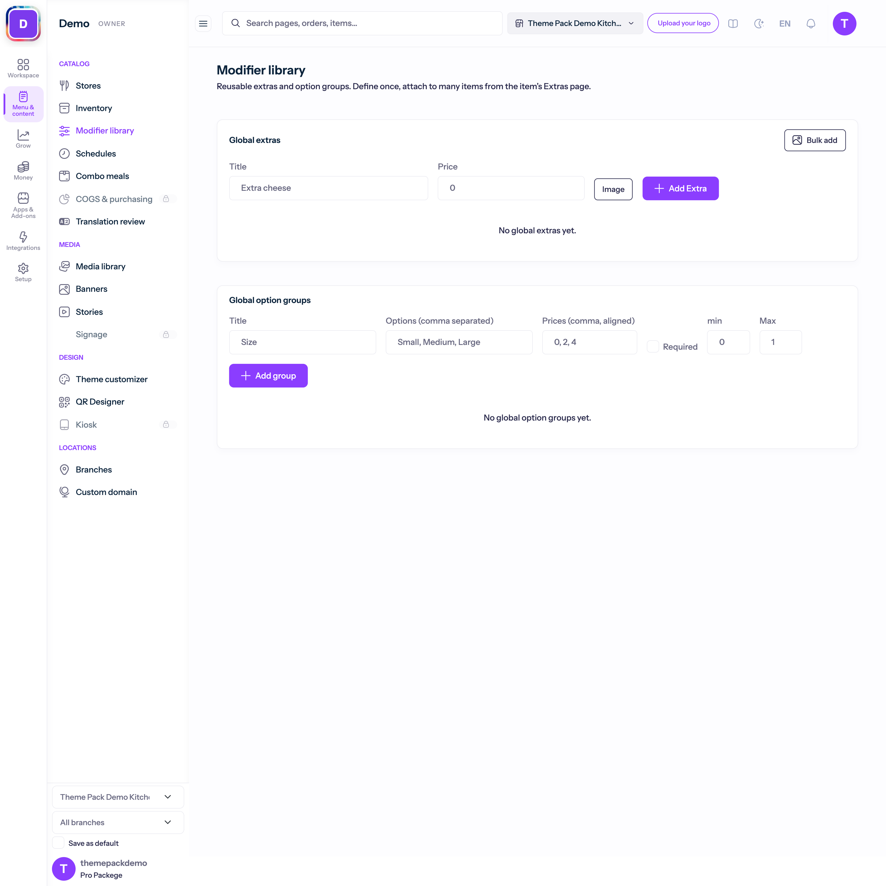

# Modifiers and options

Modifiers let customers customise a menu item before adding it to their order: extra toppings, a size choice, a cooking preference, and so on. This platform gives you a reusable library so you define a modifier once and attach it to as many items as you like. Editing it in the library updates every item that uses it.

There are two kinds of modifier:

- **Global extras** — single add-ons with their own price, for example "Extra cheese" for 2.00. A customer can add any number of the extras you attach.
- **Global option groups** — a titled set of choices, for example a "Size" group with Small, Medium, Large. Each option can carry its own price, and the group has selection rules (required, minimum, maximum).

## Where to find it

In the dashboard sidebar, open **Modifier library**. If your account has more than one restaurant, pick the restaurant at the top of the page first; the library is scoped to a single restaurant. When you have only one restaurant it is selected automatically.

From here you manage the two lists — Global extras and Global option groups — and see how many items each one is used by.

## Creating a global extra

In the **Global extras** card, fill the add row:

- **Title** — the name the customer sees, for example "Extra cheese".
- **Price** — the amount added when the customer picks this extra. Enter 0 for a free add-on.
- **Image** (optional) — pick an image from your [media library](media-library.md).

Select **New add-on** to save it. Each extra shows its price, an **Used by** count of how many items reference it, and an Active or Inactive state.

Use **Edit** to change the title, price, image, or to toggle the extra Active. Turning it inactive hides it from customers without deleting it. **Delete** removes the extra from every item it was attached to, so you are asked to confirm first.

## Creating a global option group

In the **Global option groups** card:

- **Title** — the group name, for example "Size" or "Cooking preference".
- **Options (comma separated)** — the individual choices, for example `Small, Medium, Large`.
- **Prices (comma, aligned)** — an optional price for each option, in the same order as the options. For `Small, Medium, Large` you might enter `0, 2, 4` to add nothing for Small, 2.00 for Medium, 4.00 for Large. Leave this blank if all choices are free. Any prices you enter line up position-by-position with the options; if you leave the whole field blank the group is free.
- **Required** — tick this if the customer must make a choice from the group before ordering.
- **Min** and **Max** — how many options the customer may select. Min is the fewest they must pick (0 means optional); Max is the most (leave Max blank for no upper limit). Both accept 0 to 50.

Select **Add group** to save. The list shows the options, a rule badge (Required plus the min–max range), and the **Used by** count.

**Edit** lets you change the title, options, prices, the required flag, min and max, and toggle the group Active. As with extras, **Delete** removes the group from every item and asks you to confirm.

## Translating modifiers

If your menu has more than one language, an **Editing language** switcher appears at the top of the library. Create your extras and groups in your default language first, then switch language and use **Edit** to translate the title (and, for groups, the option labels). Prices and images are shared across all languages — you only translate the wording.

## Attaching modifiers to an item

You attach modifiers from the item itself, not from the library page.

1. Open **Menu** and choose the restaurant, then open the item you want and go to its **Extras & Variants** page (see [Menu items](menu-items.md)).
2. Scroll to the **Library** section. It has two panels: **Global extras** and **Global option groups**, listing everything in your library for this restaurant.
3. Select **Attach** next to the extra or group you want on this item. It immediately shows an **Attached** badge.
4. To remove it from this item, select **Detach**. This only removes it from the current item; the modifier stays in your library and on other items.

The **Manage library** link on that page jumps straight back to the Modifier library if you need to create something first. An attached extra uses its library price, and an attached group uses its library options, prices, and selection rules.

## How modifiers appear to customers

On your storefront, when a customer opens an item that has modifiers attached:

- **Option groups** appear as choices they select. If a group is marked Required, or has a minimum, they must satisfy that before the item can be added to the cart. The maximum caps how many options they can tick. Any per-option price is added to the item total as they choose.
- **Extras** appear as optional add-ons; each one adds its price when selected.

The item total reflects the per-option prices and extras the customer selects, and the chosen options and extras are recorded on the order and shown to your kitchen.

## Per-item extras and variants

The same **Extras & Variants** page also lets you build extras and variant combinations that belong only to that one item, separate from the shared library. Reach for the library when the same add-on or choice appears across many items; use per-item extras for one-off options. Both show up to customers the same way.

## Notes and limits

- The modifier library is scoped per restaurant. Extras and groups created for one restaurant are not shared with another.
- Inactive extras and groups stay in your library and on their items but are hidden from customers, which is a quick way to pause a seasonal add-on.
- Option prices align to the option order. If you reorder or change the options later, re-check the prices so they still match.
- Per-attach overrides (a different price or different selection rules for a single item) exist in the system but are not editable from the current dashboard; an attached modifier uses the library's own price and rules.
