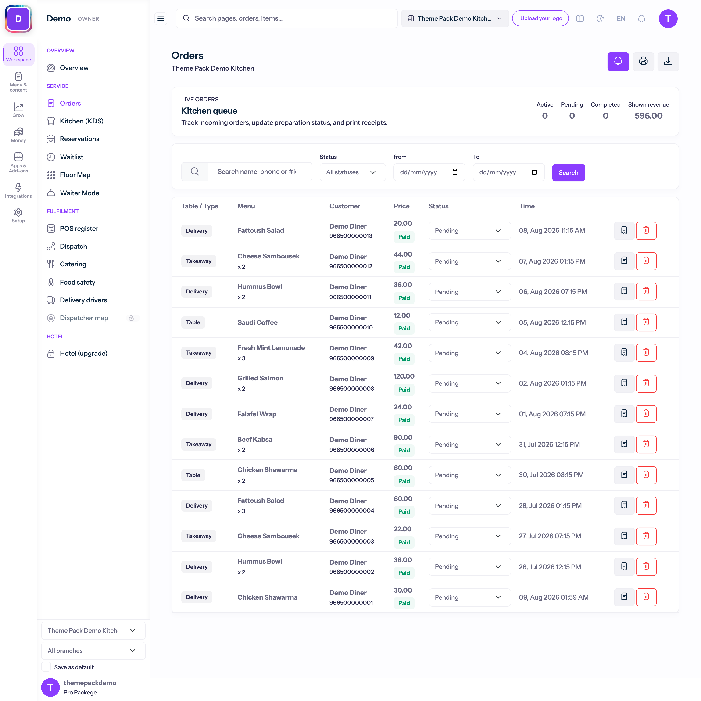

# Managing orders

When a customer places an order from your public menu, it appears in the
dashboard under **Orders** in the sidebar. This page explains the order list,
how order statuses work, what your customers see while they wait, and the
extras that ride along with an order: per-item notes, scheduled times, and
guest order history.

## The order list

Open **Orders** in the sidebar. If you have more than one restaurant, a
restaurant selector picks which one you are viewing; if you work with
branches, the list is also scoped to the branch chosen in the sidebar
switcher. Orders are shown newest first, 50 per page.

At the top of the page you get a quick summary of the orders currently shown:
**Active** (pending, preparing, or ready), **Pending**, **Completed**, and
**Shown revenue**. Below that, a search box filters the list as you type, and
a **Status** dropdown narrows it to one status. Search matches the table or
order type, customer name, phone, address, status, and order number.

Each row shows:

- **Table / Type** — the table number, Takeaway, or Delivery.
- **Menu** — the ordered items with variant, quantity, extras, and any
  per-item note (in italics under the item).
- **Customer** — name, phone, address, and the order-level message if the
  customer left one.
- **Price** — the total, any tip, and a **Paid** badge for orders paid online.
- **Status** — a dropdown to change the status (see below).
- **Time** — when the order was placed.

Row actions let you open the order as a receipt (with a **Print Receipt**
button), mark a pending order complete, or delete it (with a confirmation).

Two toggles in the page header are worth turning on for a busy counter:

- **New order sound** — plays a chime when a new order arrives.
- **Auto-print new orders** — reloads the page when a new order comes in so
  it is ready to print.

The page checks for new orders automatically about every 25 seconds, so you
do not need to refresh. Orders started with online payment stay hidden until
they are paid, and abandoned unpaid orders are cleaned up automatically after
three hours.

## Statuses and how to change them

Every order moves through a simple lifecycle:

- **Pending** — just received, nothing done yet.
- **Preparing** — the kitchen is working on it.
- **Ready** — ready for pickup, serving, or dispatch.
- **Completed** — handed over; the order is done.
- **Cancelled** — the order will not be fulfilled.

To change a status, pick the new value from the **Status** dropdown on the
order's row. You can move an order to any status at any time — there is no
forced sequence — and each change records a timestamp (started preparing,
became ready, completed, or cancelled). These timestamps are not shown on the
Orders page; they drive the customer's live tracking page (below).

If you have SMS or WhatsApp set up, you can also notify the customer
automatically on every status change. In **Stores → Edit → Ordering**,
under **Customer SMS alerts**, turn **Status-update SMS** on (or the matching
WhatsApp option). The customer then receives a short message such as
"your order #12 is now ready" at the phone number they gave at checkout.

## What the customer sees (live tracking)

Every order gets a private tracking page reached through a long, random link,
so customers cannot guess each other's orders. After checkout the customer is
given this link, and the page shows a step-by-step tracker (order received,
preparing, ready, completed) that refreshes by itself every few seconds as you
change the status in the dashboard. Cancelled orders show a cancelled state.
No login is needed — the link itself is the key.

## Prep-time estimate (ETA)

The tracking page can also show the customer a live "ready in about 20–30
min" line while the order is being prepared. The estimate is automatic: it
is built from your own last 30 days of orders (how long dishes actually took
between **Preparing** and **Ready**), then adjusted for how busy the kitchen
is right now and for unusually large orders. It refreshes on its own and
disappears the moment you mark the order ready — from then on the page shows
actual times, never a guess.

Two things to know:

- The estimate needs history. It stays silent until it has at least 20
  completed orders with both the preparing and ready steps recorded — so it
  only works if you (or your staff) actually move orders through the
  statuses rather than jumping straight to completed.
- You can set a fallback for the quiet period. In **Restaurants → Edit →
  Ordering**, fill **Prep-time estimate fallback (minutes)** in the form
  `25-35`. That range is shown whenever there is not enough history for an
  automatic estimate. Leave it empty and no estimate is shown until the
  automatic one kicks in.

## Per-item notes

Customers can attach a short note to each line in their cart (for example
"no onions") in addition to the order-level message. The note is saved with
that line and shows in italics directly under the item in the order list, so
the kitchen sees which dish it belongs to. Orders without notes look exactly
as before.

## Voice notes on orders

Customers can also attach a short spoken message to an order — useful for
allergies, directions, or anything easier said than typed.

Turn it on in **Stores → Edit → Ordering** with **Accept voice notes on
orders** (it is off by default). At checkout the customer then sees an
optional **Voice note** recorder: one note per order, up to 60 seconds. If
their browser cannot record or they refuse the microphone, the widget hides
itself and checkout continues normally.

On your side, an order that carries a voice note shows a small audio player
on its row in the order list — press play to hear it, with the note's length
next to it. The same player appears on the kitchen display, in the POS, and
in the staff mobile app, so whoever handles the order can listen. Recordings
are stored privately and are only playable by your signed-in staff (and by
the customer who recorded it).

A second setting, **Transcribe voice notes automatically** (on by default),
turns each note into a short text line shown under the player, so staff can
read the request at a glance without headphones. Transcription needs a
voice-capable AI provider (for example Groq or OpenAI) configured on your
account; without one, the audio player still works and only the text line is
missing. Transcription never delays or blocks the order.

## Order scheduling (order for later)

Customers can place an order now for a later time:

1. Go to **Stores**, edit the restaurant, open the **Ordering** tab, and
   set **Order scheduling** to Yes.
2. At checkout the customer then sees an optional **Schedule for later** date
   and time picker, limited to at least 30 minutes ahead.

The chosen time is saved with the order. Note: the scheduled time is not yet
shown on the Orders page or on receipts — surfacing it in the dashboard is
planned but not yet available, so for now confirm pre-order times with the
customer directly.

## Guest order history and reorder

Customers do not need an account to find their past orders. On your public
menu there is a **Track my previous orders** section: the customer enters the
phone number or email they used at checkout and gets their last 10 orders at
your restaurant, each with its date, status, total, and a link to its tracking
page. Anything more detailed, such as the address or item list, stays behind
the private tracking link.

Customers who are logged in to a customer account additionally get a
**Reorder This Order** button in their account page. It puts the same items —
with the same variants and extras — back into the cart in one tap. Items that
are sold out or no longer on the menu are skipped with a notice; if none of
the items are still available, the reorder is refused with a message.

## Related pages

- [Dashboard overview](dashboard-overview.md) — where Orders sits in the
  sidebar and how plan meters work.
- [Managing menu items](menu-items.md) — sold-out toggles and availability,
  which affect what can be ordered and reordered.
