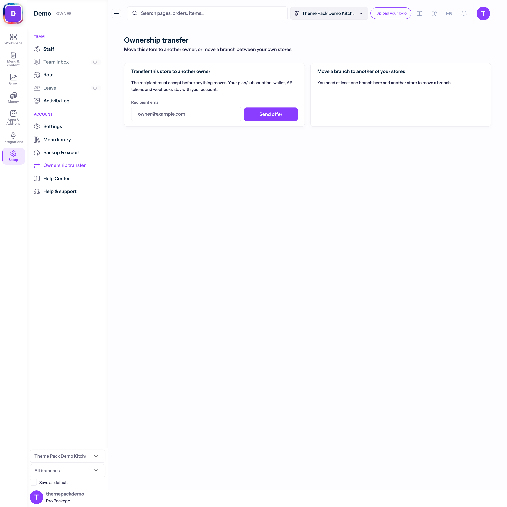

# Ownership transfer

Hand a whole restaurant over to another account, or move a branch between
two restaurants you own. Open **Ownership transfer** in the dashboard sidebar
under **Setup → Account** (exchange icon); the page also lives at `/transfer`
on your dashboard domain. It always works on the store currently selected in the dashboard
store switcher. Only the store's owner can use it.

## Transferring a store to another user

A store transfer is two-party: you make an offer, and nothing changes hands
until the recipient accepts it from their own account.

1. On the transfer page, enter the recipient's **email address**. It must
   belong to an existing account on the platform (and not your own).
2. Send the offer. The recipient gets an email notification, and the offer
   appears under your **outgoing** offers as pending.
3. The recipient signs in and sees the offer under **Stores offered to you** on
   their own transfer page, with a summary of what the store contains. They
   can **Accept** or **Decline**.
4. On accept, ownership of the restaurant — its menu, orders, settings and
   everything attached — moves to the recipient's account. Ownership is
   re-checked at the moment of acceptance, and every applied transfer is
   audited.

Rules to know:

- **One pending offer per store.** You cannot send a second offer while one
  is outstanding — cancel the first one from your outgoing list.
- **Offers expire** after 7 days if not accepted.
- You can **cancel** your own pending offer at any time; the recipient can
  **decline**. Both end the offer with nothing changed.
- Transferring the store does not move your other stores, your account, or
  your subscription — it moves that one restaurant.

## Moving a branch between your own stores

If you own more than one restaurant, the same page offers a **branch move**:
pick one of the current store's branches and a destination store from your
other restaurants, and the branch moves immediately. No acceptance step is
needed because both stores are yours.

## Related pages

- [Multi-branch](branches.md) — how branches work day to day.
- [Backup, export and restore](backup-export.md) — take a full copy of a
  store's data before or after a transfer.
