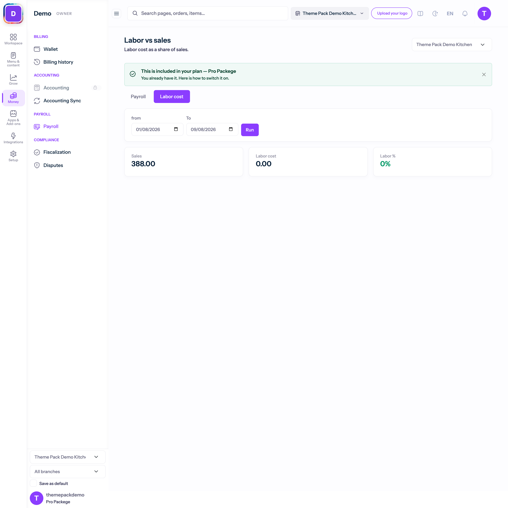

# Payroll runs

A pay run turns a date range into one line per staff member — worked hours,
overtime, paid leave, tips, adjustments and a net figure — then moves through
draft → submitted → approved → paid. You can print a payslip per person and
export a bank file.

The pages are gated behind the **HR & Payroll** feature (`payroll_suite`).
Without it you get "not included in your current plan" or the upgrade page. See
[Plans and billing](plans-billing.md).

There is no sidebar link. Go directly to:

- **Pay runs** — `/payroll-runs`
- **Labor vs sales** — `/payroll-runs/labor/dashboard`

Both pages carry a two-tab strip (**Payroll**, **Labor cost**) so you can move
between them, and a restaurant dropdown at the top right if you own more than
one.

Payroll never moves money. Marking a run paid records that you paid it; the
bank file is a CSV you hand to your bank yourself.

## Creating a pay run

On `/payroll-runs`, the **New pay run** card takes a **Period start** and a
**Period end** and the **Generate** button builds the run and opens it.

Generating for a period that already has a run rebuilds that run from scratch as
a draft. If the existing run for that period is already approved or paid it is
locked and you get "This period is locked." instead.

For each staff member of the restaurant the engine works out:

- **Worked hours** — from completed clock-in/clock-out pairs in the period.
- **Rate** — the role rate from the employee file if the staff member's role has
  one, otherwise their base wage, otherwise the hourly rate on the staff record.
  See [Employee files and leave](hr-employees.md).
- **Overtime** — hours above the weekly threshold (48 by default, scaled by the
  number of weeks in the period) are paid at the rate times a multiplier (1.5 by
  default).
- **Paid leave hours** — approved leave in the period on a *paid* leave type,
  counted as the standard day length (8 hours by default) per day, half that for
  a half-day request. Unpaid types add nothing.
- **Tips** — tips on orders served by that staff member in the period.

Net pay = base pay (regular hours plus paid-leave hours × rate) + overtime pay +
tips + adjustments.

The overtime threshold, overtime multiplier and standard day length are stored
per restaurant but have no settings screen — they use the defaults above unless
changed in the backend.

## Working on a run

Open a run from the list (**Open**) or straight after generating it. The header
shows the status badge, the total net, and the buttons for the current step.

The table has one row per staff member: Worked, Leave, OT (hours), Base, OT pay,
Tips, Adj, Net.

### Adjustments

While a run is still a draft or awaiting approval, each row has a small form:
type a **Reason** and an **amount** (positive for a bonus, negative for a
deduction) and press **+**. Adjustments accumulate — positives total into
bonuses, negatives into deductions — and the row's net and the run total
recompute immediately. Adjustments cannot be added once the run is locked
(approved or paid), and there is no way to remove one.

### Tip pooling

Above the table (only while the run is unlocked) is the **Tip pooling** card.
Choose a method and press **Pool & apply tips**:

- **By hours worked**
- **By role weight**
- **Custom percent**

The tip pool is every tip on paid orders in the run's period. Applying it
overwrites the Tips column on each line with each person's share; rounding is
exact, with any remainder going to the last recipient.

Note: the role weights and custom percentages themselves have no inputs on the
page, so "By role weight" and "Custom percent" run with no weights supplied.
"By hours worked" is the method that behaves as described today.

### Approval flow

- **Submit for approval** — on a draft. Moves it to *Pending approval*.
- **Approve** — on a submitted run. Records who approved it and when, and locks
  the run against edits.
- **Mark paid** — on an approved run only. Stamps the paid date. Trying to mark
  an unapproved run paid is refused.

If ledger accounting is switched on, approving posts the wages and marking paid
posts the payment; otherwise both are no-ops.

## Payslips

Each row has a **Payslip** button that opens a printable page in a new tab
(`/payroll-runs/{id}/payslip/{itemId}`). It shows the staff name, the period,
then worked hours, paid leave hours, overtime hours, base pay, overtime pay,
tips, bonuses, deductions and net pay. The **Print / Save PDF** button at the
top uses your browser's print dialog; it does not appear on the printout.

Payslips are not emailed or sent to staff automatically — print or save and send
them yourself.

## Bank file

**Bank file (CSV)** on the run header downloads `payroll-<run id>.csv` with one
row per staff member: staff name, national ID (from the employee file) and the
net amount. It is an export only — no payment is executed and no bank is
contacted.

## Labor vs sales

`/payroll-runs/labor/dashboard` compares what you spend on people with what you
take.

Pick a **From** and **To** date (defaults: start of this month to today) and
press **Run**. Three tiles show:

- **Sales** — total of paid orders created in the window.
- **Labor cost** — total net of every pay run whose period overlaps the window.
- **Labor %** — labor as a percentage of sales, or "—" when there are no sales.

The percentage turns red with an **Above threshold** badge when it goes over the
threshold for the restaurant (30% by default). That threshold has no settings
screen.

Because labor comes from whole pay runs that *overlap* the window rather than
being split by day, pick a window that matches your pay periods for a
meaningful number.

## The other payroll page

There is a second, simpler report at `/rota/payroll`, reached from the rota's
**Payroll** button: scheduled versus worked hours, pay and tips, with a CSV
export and no run, approval or payslip. Use it for a quick check; use pay runs
when you actually need to pay people. See
[Staff scheduling](staff-scheduling.md).

## Related pages

- [Employee files and leave](hr-employees.md) — wage rates and paid leave that
  feed the run.
- [Staff scheduling](staff-scheduling.md) — the rota and the quick payroll
  report.
- [Staff](staff.md) — staff records, roles and time clock.
- [Plans and billing](plans-billing.md) — enabling the HR & Payroll feature.
