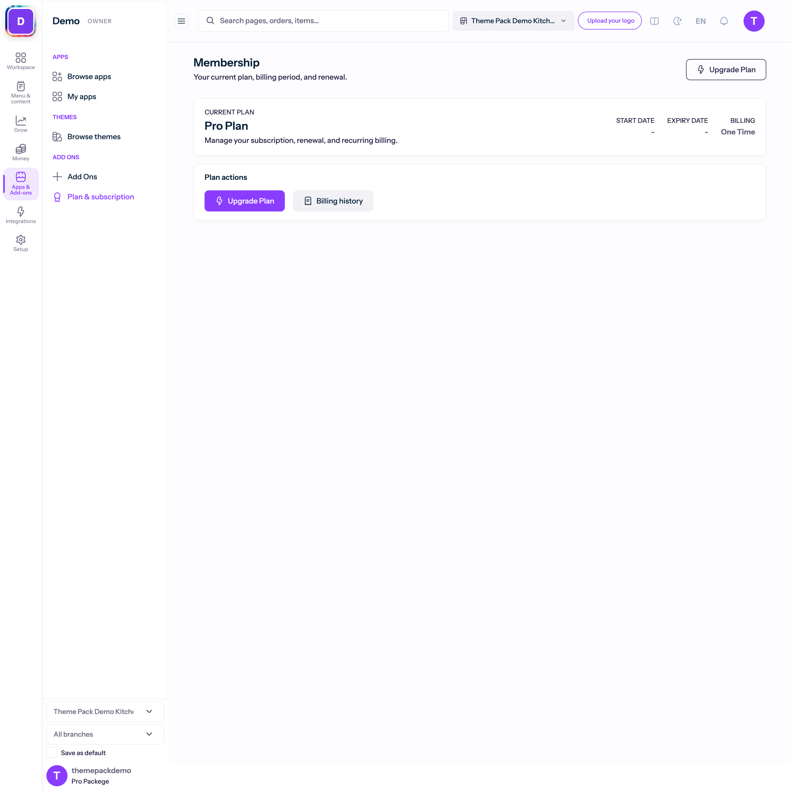

# Plans, billing and subscriptions

Your account is on a plan. The plan decides how much you can do — how many
restaurants you can run, how many QR scans you get per month, how many menu
categories and items each restaurant can have — and which features are turned
on. This page explains how to read your usage, upgrade, buy add-ons, and manage
renewals and invoices.

## Choosing a plan

Open the **Pricing** page (the `pricing` link, in the site header and footer, or
go to `/pricing`). It lists every active plan with a billing-period toggle:

- **Monthly** — billed each month.
- **Yearly** — billed once a year, usually at a discount. Shown only when the
  plan has an annual price.
- **Lifetime** — a single one-time payment, no renewal. Shown only when the plan
  has a lifetime price.

Each plan is shown as a compact card — its price, a short set of headline
features and a call to action — and below the cards a grouped **comparison
table** lays out every feature so you can see what differs between plans. Use the
**Compare all features** link under the cards to jump to the table; click a group
heading to collapse or expand its rows.

Switch the toggle to see each plan's price for that period. Two special plans may
also be offered:

- **Free** — the plan you fall back to automatically when a paid plan ends. You
  cannot "buy" it; if you pick it, you keep your current plan until it expires
  and then drop to Free.
- **Trial** — a time-limited free run of a paid plan. Each account can use the
  trial only once; after that the option is refused.

To subscribe, choose a plan and interval and continue to checkout. You must have
a verified email address first — otherwise checkout sends you back to the pricing
page with a prompt to verify.

## What the limits mean

Every plan carries a set of limits, stored per plan:

- **Restaurants** — how many restaurants (menus) you can create.
- **Scans per month** — QR-code / menu views counted per calendar month.
- **Categories** — menu categories allowed per restaurant.
- **Menu items** — items allowed per category.

A limit value of **unlimited** means there is no cap (internally the number
`999` is treated as unlimited). Your plan also switches individual features on or
off — for example online ordering or table QR — and an administrator can disable
a feature platform-wide regardless of your plan.

When you buy an [add-on](#add-ons) that raises a limit, the extra capacity is
added on top of your plan's limit everywhere the limit is enforced, so the number
you see already includes any add-ons.

One edge case is visible rather than silent: bounded limits are capped at 998
(999 is reserved to mean unlimited). If your plan base plus purchased add-ons
would total more than 998 for a limit, the surplus is not granted — and the
Add-ons page tells you so (see
[Truncated add-on capacity](#truncated-add-on-capacity)). Scan packs are
exempt from this cap.

### Orders per month (Free plan)

Some plans include a number of orders per store per calendar month (on juwri
Cloud: 200 on the Free plan). It is a **soft** limit: orders above it are still
accepted, so customers are never turned away. When a store reaches 75% of the
number (150 of 200) you get a notice at the top of the dashboard and one email;
when it reaches the number you get another notice and email suggesting a plan with
unlimited orders, and the notice stays on every dashboard page until the month
ends. Paid, unpaid and later-cancelled orders all count. The month follows your
store's timezone, and the count starts again on the 1st.

## Seeing your usage

The **dashboard** (your home page after login) shows a **Plan usage** strip with
meters for restaurants, this-month scans, and menu items. Each meter reads
`used / limit`, or `used / Unlimited` when the plan has no cap, with a bar
showing how close you are.

You also see contextual usage where it matters:

- **My restaurants** — the restaurants used / limit near the create button.
- **Menu builder** — categories and items used / limit while you edit a menu.

When you are at a limit, the create action is blocked and you are pointed to
upgrade. Raise the limit by moving to a bigger plan or buying an add-on.

## Upgrading or changing plan

From the **Membership** page (reached from the trial banner's "Upgrade Now"
link, the past-due banner, or the "Upgrade plan" prompts near a limit) select
**Change plan** to return to pricing, then pick the plan and interval you want.
Checkout then:

1. Asks for your **billing details** (name, address, country, optional tax ID).
   These are saved and reused on future invoices.
2. Applies a **coupon** if you enter one (see below).
3. Adds any **taxes** configured for the plan and your billing country.
4. Applies a **proration credit** if you are mid-cycle on a paid plan (see
   [Annual billing and proration](#annual-billing-and-proration)).
5. Hands you to your chosen payment gateway to pay.

You cannot check out for the plan you are already on — checkout refuses it and
sends you back to pricing. If the final price comes to zero (for example a
100%-off coupon), the plan activates immediately with no gateway step.

### Coupons

Enter a coupon code at checkout. A coupon can be a percentage or a fixed amount
off, and it is rejected if it has expired, hit its usage limit, or is restricted
to a billing interval other than the one you chose. Coupon usage is only counted
once payment succeeds.

## Annual billing and proration

Prices differ by interval — monthly, yearly, or lifetime — and the interval you
pick is carried through checkout to your subscription and invoice.

If you change plan or interval **mid-cycle** while on an active paid plan, the
checkout credits the unused time left on your current plan against the new
charge. The credit is the old plan's daily rate multiplied by the days remaining
until your current plan would have ended, and it is shown on the checkout page
before you pay ("prorated"). The credit can reduce the amount due but never takes
it below zero. Lifetime plans are not prorated.

## Renewals and dunning

How a paid plan renews depends on how you paid:

- **One-time** payments (including lifetime) do not auto-renew. When the period
  ends the plan lapses to Free unless you buy again.
- **Recurring** subscriptions (set up through Stripe, PayPal, or Paddle)
  renew automatically through the gateway. You can stop future renewals from the
  **Membership** page with **Cancel recurring**; you keep the plan until the
  paid period ends.

There is also an optional **wallet auto-renew**: if you opt in and keep enough
[wallet](wallet.md) balance, the system debits your wallet to renew the plan at
the end of each period.

When a renewal cannot be collected, you are not cut off immediately. The
subscription moves to **past due** with a grace period (3 days by default), and a
red banner appears in the dashboard asking you to update your payment method.
Reminder emails are sent as the period ends and through the grace window. If the
charge still cannot be collected by the end of grace, the plan expires and drops
to Free. A successful charge returns you to active.

## Invoices and billing history

Open **Billing history** (the `transactions` page, linked from the Membership
page) to see your successful and pending payments. Each successful, non-zero
payment has an **invoice**: open it to view the line item, applied taxes, and
your billing details. Every invoice gets a sequential invoice number the first
time it is opened.

Use **Download PDF** on the invoice to save or print a copy (it opens the
printable invoice and triggers your browser's print / save-as-PDF dialog). Free
(zero-amount) transactions such as trials have no invoice.

## Add-ons

Add-ons raise a specific limit without changing your plan. Open **Extensions** in
the sidebar under **Apps & Add-ons → Extensions** to see your current
effective limits and buy more. Under a reseller's own brand this page is hidden.

At the top the page shows your effective limit for stores, scans, categories and
menu items, and a separate meter for **WhatsApp messages this month** (used
against your allowance, with a "Close to your limit" badge past 80%). When you
pass 80% of any capacity limit, a warning at the top names which ones. "Unlimited"
means the limit has no cap.

The pack catalog is set by the platform, so the exact packs, quantities and
prices you see on the Add-ons page are authoritative. The default catalog
looks like this (what each grants):

| Add-on | Grants | Billing |
| --- | --- | --- |
| Extra Restaurant Slot | +1 restaurant | one-time |
| 10,000 Extra Scans/mo | +10,000 scans that month | one-time or monthly |
| Extra Menu Categories | +10 categories | one-time |
| Extra Menu Items/Category | +20 items | one-time |
| 1,000 Extra WhatsApp Messages/mo | +1,000 messages that month | one-time or monthly |

Prices are shown in the platform currency on the Add-ons page and may vary by
platform. Restaurant, category, and menu-item packs
are **permanent** capacity boosts. Scan and WhatsApp packs are **monthly**
allowances that reset at the end of the calendar month.

To buy one, pick a pack and pay with an enabled gateway or from your **wallet**
balance. Nothing is granted until payment is confirmed. For the scan and WhatsApp
packs you can choose monthly billing, which auto-renews each cycle — through
Stripe or PayPal for card payments, or by debiting your wallet each month. You
can **cancel** a monthly add-on from the Add-ons page; the extra capacity stays
until the end of the period you have already paid for.

The exact packs and prices are set by the platform, so what you see may differ
from the table above.

### Truncated add-on capacity

Bounded limits are enforced with a hard cap of 998 (999 is reserved to mean
unlimited; scan allowances are exempt). If your plan base plus purchased
add-on packs adds up to more than 998 for stores, categories, or menu items,
the surplus above 998 is not granted. When that happens the Add-ons page —
the page where you bought the capacity — shows a warning at the top naming
the affected limit:

> Your plan plus add-ons totals **1,010** Menu Items, but this account is
> capped at **998**. Contact support.

Enforcement is unchanged by the notice — it exists so the shortfall is
visible instead of silent. If you see it, contact support (your platform
provider can see the same purchased-versus-granted pair on your account) to
arrange a refund, a plan change, or an unlimited limit.

### Feature unlocks

Below the capacity packs, a **Feature unlocks** section may list one-off
purchases that switch a single feature on for your account instead of raising a
limit. A feature you already have — through your plan, an operator override, or
an earlier purchase — is hidden from the list, and trying to buy it anyway
simply tells you "You already have this feature" rather than charging you again.

Looking for features rather than capacity? The Add-ons page links across to the
App Store.

### Your add-ons

The **Your add-ons** table at the bottom lists everything you have bought: the
pack, the quantity it granted, its expiry (or **Never**), its transaction
reference, when you bought it, and its renewal state — **Wallet auto-renew**,
**Card auto-renew**, **Cancelled**, or nothing for a one-time purchase. The
**Cancel** button appears only on an active subscription.

## Pricing page display (platform operators)

Two platform-side controls shape how the pricing page reads. They are set by the
platform operator, not by a restaurant owner:

- **Marketing features per plan.** Each plan carries a *Marketing features
  (pricing page)* field (Admin → Plans → edit a plan). Enter one line per
  feature, up to six — these become the headline bullets on that plan's compact
  card. Leave it empty and the card auto-generates a short list from the plan's
  limits and the features it switches on.
- **Comparison table on the home page.** The general settings screen (Admin →
  Settings) has a *Show pricing comparison table on home page* switch, on by
  default. Turning it off hides the comparison table on the **home page only** —
  the dedicated `/pricing` page always shows it. The table rows come from the
  plans' limits and enabled features, so a row that no plan offers is not shown.

## Related pages

- [Wallet](wallet.md) — top up balance and pay for plans or add-ons from it.
- [Checkout settings](checkout-settings.md) — ordering and payment configuration
  for your restaurants (separate from your own subscription billing).
- [Coupons](coupons.md) — discount codes you create for your customers (not the
  same as subscription coupons entered at plan checkout).

## Plan quotas and limits

Each plan sets the **quotas** for what it includes — how many stores you can
run, how many menu items, how many WhatsApp messages or staff seats, and which
features are unlocked. When you approach or hit a quota, the dashboard tells you
which limit you have reached and what upgrading would raise it to, instead of
failing silently. An "unlimited" quota is shown as such rather than as a number.
If you add capacity through add-ons, your effective quota is the plan plus its
add-ons; where that would exceed an internal cap, the Add-ons page surfaces the
shortfall rather than quietly truncating it.

## Notes and limitations

- **Currency** — plans and invoices use the single platform currency; per-plan
  multi-currency pricing is not available.
- **Interval-locked coupons** — a coupon can be scoped to a billing interval, but
  a "first period only" discount flag is stored metadata and not yet enforced by
  the recurring gateways.
