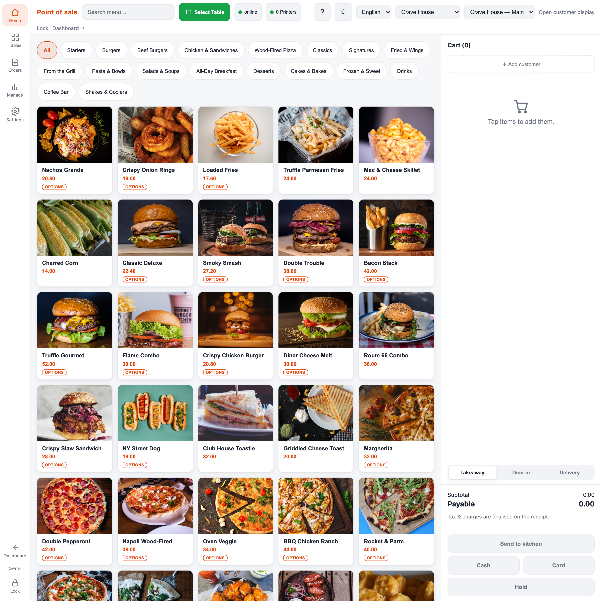

# Point of sale (POS)

The POS register is a full-screen till for taking orders at the counter or at
the table. Staff tap menu items, choose the order type, and either send the
order straight to the kitchen or take payment on the spot. Everything rung up
at the register lands in the same **Orders** list as your online orders, and
sent orders appear on the kitchen display (KDS) immediately.

## What you need before you start

- **A plan with POS enabled.** If your plan does not include POS, the register
  answers "POS is not enabled on this plan". Check your plan on the
  **Subscription** page or ask your platform provider.
- **Staff accounts (optional).** You, the owner, can always run the register
  yourself from your own dashboard. To let employees use it, create accounts
  under **Staff** in the sidebar (Team section). The **manager**, **cashier**,
  and **waiter** roles include POS access; the **kitchen** role does not.
  Managers additionally get refund and shift-close rights. See
  [Staff accounts](staff.md) to fine-tune permissions per person.
- Staff sign in on your dashboard domain with the email and password on their
  staff account. Each staff member is tied to your restaurant (and to their
  branch, if you pin one), so a dedicated till just needs a browser signed in
  as that staff member.

## Opening the register

Open **POS register** in the sidebar (Platform section) — it opens in a new
tab as a full-screen dark register at `/pos`.

- If you own more than one restaurant, a restaurant selector in the top bar
  switches the register between them. Staff cannot switch — they are pinned to
  their restaurant.
- If the restaurant has branches, a branch selector appears next to it. Orders
  are recorded against the selected branch; staff pinned to a branch default
  to it.
- The **Dashboard →** link on the right takes you back (owner only).

## Taking an order

1. Pick a category from the chips above the item grid, or **All**.
2. Tap an item to add it to the cart on the right. Tapping the same item again
   increases its quantity; use the minus and plus buttons on a cart line to
   adjust it (dropping to zero removes the line). Sold-out items cannot be
   added.
3. Choose the order type: **Takeaway**, **Dine-in**, or **Delivery**.
4. Finish with one of the four action buttons:
   - **Send to kitchen** — creates the order unpaid and puts it on the kitchen
     display. Take payment later (for example, after the meal).
   - **Cash** — takes cash payment now (see below), then sends the order to
     the kitchen as paid.
   - **Card** — marks the order paid by card and sends it to the kitchen. The
     register does not charge the card itself; use your physical card terminal
     alongside it.
   - **Hold** — parks the order. A held order does not reach the kitchen and
     does not deduct stock until it is resumed.

The cart shows a running subtotal. Prices are always calculated on the server
from your menu — the register only sends item ids and choices, so a tampered
screen cannot change a price. Tax and service charges are finalised on the
receipt.

### Variants, extras, and notes

An item with sizes, choice groups, or paid extras opens a **customise sheet**
instead of dropping straight into the cart: pick the variant (single choice),
any choice-group options (radio buttons when only one is allowed, checkboxes
otherwise), tick **Add extras**, set the quantity, and add an optional
kitchen note for the line. Option upcharges are shown next to each option;
as everywhere on the register, the price is re-calculated by the server from
your own menu definitions when the order is placed.

### Discounts and coupons on an order

Under the cart lines, two add-rows apply order-level adjustments:

- **＋ Discount** — an amount or percentage off the order (switch between
  **Amount** and **%**), with a **Clear discount** control to remove it.
- **＋ Coupon** — enter one of your [coupon](coupons.md) codes; it is checked
  against the server and shown on the cart when applied.

### Combo meals

If your account has combo meals enabled, the register shows a **Combos**
chip next to the category chips, and combo tiles (marked with a **Combo**
badge) in the item grid. Tapping a combo tile opens a configurator sheet:
one section per slot (a single choice shows radio buttons, multi-pick slots
show checkboxes), with required slots and min/max picks enforced, plus
quantity and an optional note. Options can carry an upcharge, shown next to
the option. As with everything on the register, the price you see is display
only — the server re-prices the combo from your own combo definitions when
the order is placed.

Combos themselves are built on the dashboard **Combo meals** page (at
`/combos`): pick a store, bundle existing menu items into slots, set the
price, and toggle each combo on or off. A combo only appears on the register
(and the storefront) while it is on and its items are sellable at the
selected branch.

## Payment methods

An order can be settled as **cash**, **card**, **online**, or **other**. The
settle screen shows the order lines and totals on the left and the payment
controls on the right:

- **Cash** — a keypad takes the **Cash tendered** amount and shows the change
  as you type. The change is recomputed from the real order total on the
  server. Cash sales are stamped onto the open drawer shift (see below) so
  the drawer count works out.
- **Card** — records the order as paid by card. Built-in card processing
  (live gateway keys, pay-at-table links, tap-to-pay terminals) is planned,
  not yet available, so the actual charge happens on your standalone card
  machine.
- **Tip** — quick chips for **None**, **10%**, **15%**, **20%**, or a
  **Custom** amount; the payable updates to **To collect** with the tip
  included.
- **Split** — settle the order in parts (for example half cash, half card, or
  per guest); each part is recorded against the order until it is fully
  paid. For the customer-facing split flow on the menu, see
  [Split bill](split-bill.md).

A coupon can also be applied at settle time, and when the order has an
attached customer with store-credit balance, a **Use wallet** toggle applies
their credit against the amount due.

## Cash handling and drawer shifts

POS supports proper drawer accounting, run from the register's **Manage**
panel (Shift tab):

- With no shift open, enter the **Opening float (drawer cash)** and press
  **Open shift** — one open shift per restaurant and branch at a time.
- Every cash sale settled while the shift is open is attached to it.
- While the shift runs, **X report (so far)** shows the same report as a
  close, without closing anything.
- To close, enter the **Counted cash (end of shift)** and press **Close
  shift** (needs the manager **pos_shift_close** permission). The system
  compares counted cash against expected cash (opening float + cash sales −
  cash refunds) and records the over/short.
- Closing produces a **Z-report** card: **Orders**, **Opening float**, sales
  by payment method, **Tips**, **Refunds**, **Voids**, **Expected cash**,
  **Counted cash**, and **Over / short**.

The Manage panel's **Reports** tab carries the per-day POS sales report
(totals by payment method, staff, and hour).

Mistakes are handled with two manager-gated tools (**pos_refund**
permission), reached from the register's orders hub: open the order's detail
panel and use the button that applies. Each action requires a **Reason** and
is recorded permanently with the staff member who did it:

- **Void order** — for unpaid orders. Voiding cancels the order so it leaves
  the kitchen and restores stock. A paid order cannot be voided (the button
  only appears on unpaid, non-cancelled orders).
- **Refund** — for paid orders. Records the money out with an amount and
  reason; the panel shows the **Already refunded** running total, and cash
  refunds count against the drawer.

Orders can also be moved between tables, and tables merged into one party,
from the tables view (**Merge tables** and the move-order sheet).

## The orders hub

The register's orders panel gathers everything that is not the live cart into
tabs: **On hold** (parked orders, resume to continue), **Online orders**
(orders placed outside the register — from your public menu — so the counter
sees them arrive), **Order history** (recent register orders; a row opens the
detail panel with reprint, void, and refund), and **Offline** (orders queued
while the connection was down, with a badge showing the queue count). Stores
using order approvals also get an **Approvals** tab.

## Receipts and kitchen tickets

Every POS order has a printable 80mm receipt at `/pos/orders/{id}/receipt`
(it opens ready to print). The receipt shows your restaurant name, address,
and phone, the order number, type and table, each line with quantity and
price, extras, subtotal, tax, service charge, tip, discount, the grand total,
and — for cash — the tendered amount and change. The tax line uses the
**Tax rate** you set in **Stores → Edit**.

Adding `?format=kitchen` to the same address prints a kitchen ticket instead
of a customer receipt.

You can also reprint any order from the **Orders** page in the dashboard —
the receipt icon on a row opens a drawer with a print button. By default,
printing goes through the browser's print dialog. If your plan includes
**Print Routing**, the dashboard **Printing** page adds direct printing —
per-branch and per-kitchen-station printer profiles with automatic printing
on new orders. See [Printing](printing.md) for both.

## The floor view

A dedicated floor screen is available at `/pos/floor`. It shows each table's
state — occupied tables with their order total and free tables with their seat
count — and an order can be transferred between tables, which marks it as
dine-in on the new table. Lay your tables out on the [floor map](floor-map.md)
so they appear on this screen.

## POS settings

Managers and owners can open POS settings from the register (or directly at
`/pos/settings`). The settings page lets you configure per-branch print and
station behaviour:

- **Auto print** — Off, Receipt only, Kitchen ticket only, or Both.
- **Copies** — number of copies to print (1 to 5).
- **Station name** — a label for this register (up to 40 characters), useful
  when you run more than one till.
- **Autolock minutes** — how long the register sits idle before it locks
  itself (0 to 120; 0 means never).

Settings are saved per branch (or per restaurant when no branch is selected).

## Customer-facing display

Open the customer display from the register header link, or go to
`/pos/display` directly. This is a second-screen view intended for a
customer-facing monitor mounted at the counter. It mirrors the current cart
in real time using a broadcast channel with a five-second polling fallback,
so the customer sees items and totals as you ring them up.

## Quick-switch unlock

When the register locks (after the autolock timeout, or manually), a PIN or
password overlay appears. Two unlock paths are available:

- **PIN** — a staff member enters their 4-to-6-digit PIN. The register
  switches to that staff member's session (name and role update on screen),
  so several staff can share one till without signing out.
- **Password** — the owner re-authenticates with their account password.

## Working offline

The register keeps working through a brief internet outage:

- The screen and menu are cached, so the register still loads.
- Orders rung up while offline are queued in the browser (a banner shows
  "Offline — orders will send when back online" with the queue count) and are
  sent automatically when the connection returns. Replays are de-duplicated,
  so an order is never created twice.
- Payments taken while offline settle when the order syncs — settle on the
  receipt once it arrives.

For the offline time limits, card limits and the list of things that need a connection, see
[Selling when the internet is down](pos-offline.md).

## Current limitations

- No built-in card charging: live card gateway keys and tap-to-pay terminal
  support are planned, not yet available. Card payments are only recorded;
  the actual charge happens on your standalone card machine.

## Related pages

- [Managing orders](orders.md) — where POS orders appear, statuses, and
  reprinting receipts.
- [Staff accounts](staff.md) — roles, POS permissions, and per-person access.
- [Dashboard overview](dashboard-overview.md) — sidebar layout and the
  store/branch switcher.
- [Split bill](split-bill.md) — letting dine-in guests split the payment.
