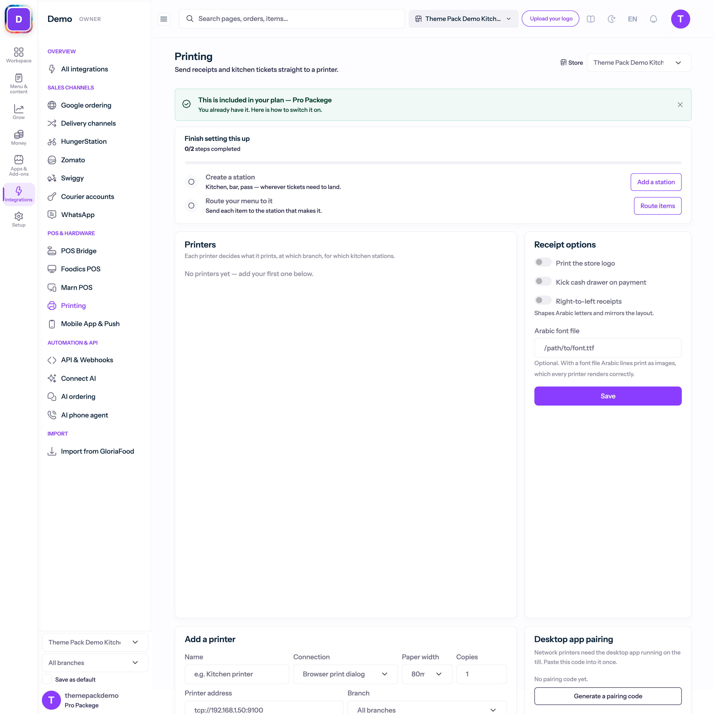

# Ticket and receipt printing

The system prints two kinds of paper: a customer **receipt** (prices, totals,
payment) and a **kitchen ticket** (large type, no prices, item notes). Both
are laid out for standard 80mm thermal roll paper. There is no third-party
cloud printing service to sign up for; two printing paths are built in:

- **Browser printing** (always available) — receipts and tickets open in a
  window and print through your browser's normal print dialog.
- **Direct printing** (the **Print Routing** feature, where your plan
  includes it) — the dashboard **Printing** page defines printer profiles
  that receive jobs directly: per branch, per kitchen station, with automatic
  printing on new orders. See [The Printing page](#the-printing-page) below.

## What prints when

- **A new online order arrives** — with Print Routing set up, a printer
  profile subscribed to the **New order** event with **Print automatically**
  on prints it hands-free. Without Print Routing, nothing prints
  automatically: the **Orders** page alerts you (sound and auto-refresh,
  described below) so the order is on screen ready to print with one click.
- **You click Print Receipt on the Orders page** — a compact receipt for that
  order opens in a small window and the print dialog appears.
- **You open a POS order's receipt link** — the 80mm receipt (or kitchen
  ticket) opens and immediately triggers the print dialog. The register also
  offers **Print receipt** / **Print ticket** buttons right after an order is
  sent.

## Reprint any order from the Orders page

1. In the dashboard sidebar, open **Orders**.
2. Find the order and open it. A drawer shows the order details: time, customer,
   type, phone, address, message, items with variants and extras, and totals.
3. Click **Print the receipt**. A small window opens with a receipt-style layout
   (your restaurant name and address at the top, the order details, and a
   thank-you line) and your browser's print dialog appears.

If the small window does not appear, your browser blocked the pop-up. Allow
pop-ups for your dashboard address and try again.

## New-order alerts on the Orders page

The Orders page checks for new orders about every 25 seconds. Two toggle buttons
sit at the top of the page:

- **New order sound** (bell icon) — plays a chime when a new order arrives.
- **Auto-print new orders** (printer icon) — refreshes the page when a new order
  arrives, so the newest order is on screen and ready to print. Despite the
  name, this toggle does not send anything to the printer by itself; you still
  click **Print the receipt**. For true hands-free printing, set up a printer on
  the [Printing page](#the-printing-page) instead.

Both toggles are remembered per device and browser, so switch them on at the
counter or kitchen computer where you actually want the alerts. Keep that
browser tab open — the alerts only work while the Orders page is open.

## POS receipts and kitchen tickets

Every POS order has a printable receipt at `/pos/orders/{id}/receipt`. You must
be signed in as the owner or as staff with POS access, and the order must belong
to your restaurant. The page opens the print dialog on its own and has a
**Print** button for reprints.

The customer receipt shows your restaurant name, address, and phone, the order
number, order type and table, date and time, each item with quantity and price,
extras, subtotal, tax, service charge, tip, discount, the grand total, the
payment method, and — for cash — the tendered amount and change. The tax line
uses the tax rate set on your restaurant's edit page. The footer text defaults
to "Thank you!"; a per-store footer override is honoured when set on the
account, but there is no dashboard field for it yet.

Add `?format=kitchen` to the same address to get a kitchen ticket instead: the
order number and type in large print, the table and time, then each item in big
bold type with its variant, extras, and any item note marked with a star. No
prices — it is meant for the pass, not the customer.

See [Point of sale](pos.md) for the register itself.

## The Printing page

When your plan includes **Print Routing**, a **Printing** item appears in the
sidebar. The page manages printer profiles — each printer decides what it
prints, at which branch, for which kitchen stations. For each printer you
set:

- **Name** — for example "Kitchen pass" or "Counter".
- **Connection** — how jobs reach the printer: **Browser print dialog**,
  **USB / serial (this browser)**, **USB (WebUSB)**, **Android (RawBT)**, or
  **Network printer (desktop app)**. A Sunmi kiosk's built-in printer shows
  here read-only (it is configured on the Kiosk page).
- **Paper width** — 80mm (48 columns) or 57mm (32 columns).
- **Printer address** — for network printers, `tcp://ip:9100`; leave empty
  for USB and browser printing.
- **Desktop app address** — where the desktop print app runs, for network
  printers.
- **Branch** — **All branches** for a store-wide printer, or one branch.
- **Copies** — 1 to 5.
- **Kitchen stations** — limit kitchen tickets to one or more
  [stations](kds.md) ("Empty = every item on one ticket"), so the bar printer
  never gets the grill's items.
- **Prints** — which events this printer handles: **New order**, **Paid**,
  **Kitchen ticket**, **Shift report**.
- **Print automatically** and **Enabled** switches.

Use **Test print** on a profile to verify the connection, and **Delete** to
remove it. Jobs are delivered by whatever owns the printer's connection — the
open POS page for USB printers, the RawBT app on an Android device, or the
desktop app for network printers — so keep that device running for unattended
printing.

## Setting up a printer (browser printing)

Browser printing happens on the computer or tablet that shows the Orders page
or POS:

1. Connect your thermal printer (USB, network, or Bluetooth) and install it at
   the operating-system level so it appears in the browser's print dialog.
2. Use 80mm roll paper. The receipt and ticket layouts are 72mm wide to fit the
   printable area of an 80mm printer.
3. In the print dialog, pick the thermal printer, set margins to none, and turn
   off headers and footers. Most browsers remember these choices.
4. Setting the thermal printer as the device's default printer makes each print
   a single click.

Any printer the browser can see will work — a regular A4 printer prints the same
layouts, just on larger paper.

## Not available yet

- **Third-party cloud printing** — there is no PrintNode or similar hosted
  service integration. Unattended printing works through the built-in Print
  Routing paths instead (USB on an open POS page, Android RawBT, or the
  desktop app for network printers), so a device on your network still has to
  be on.
- **Custom receipt footer** — the footer text on the POS receipt has no
  dashboard setting yet (a per-store override is honoured when set on the
  account).
- Without the **Print Routing** feature on your plan, everything above in
  [The Printing page](#the-printing-page) — unattended auto-print, per-station
  and per-branch routing, and copy counts — is unavailable, and printing is
  browser-dialog only.

## Related pages

- [Managing orders](orders.md) — the Orders page where reprinting and the
  new-order alerts live.
- [Point of sale](pos.md) — the register, settling payments, and the
  receipt/kitchen-ticket links.
- [Kitchen display system (KDS)](kds.md) — the stations that per-station
  ticket routing keys off.
- [Kiosk](kiosk.md) — the Sunmi kiosk's built-in printer.
