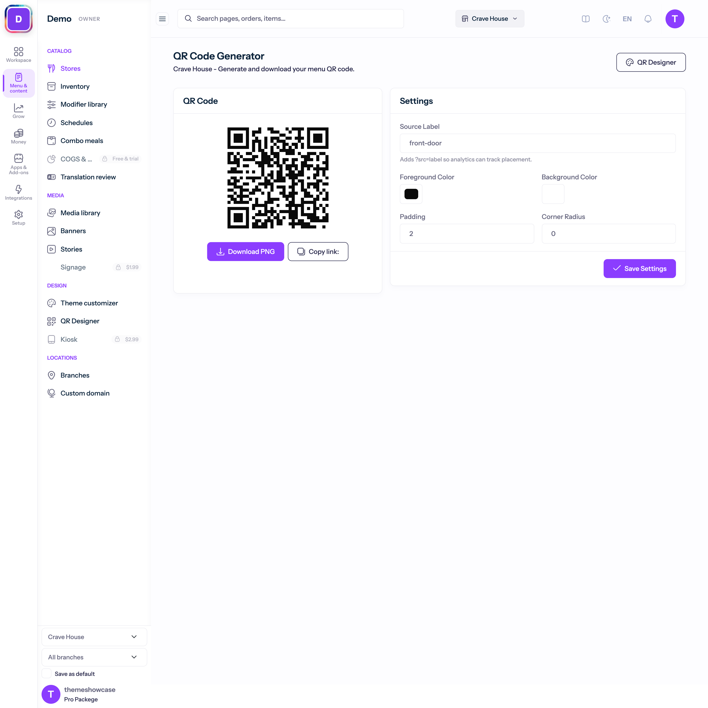

# QR codes and sharing

Every restaurant has a public menu at its own web address. QR codes are the
main way diners reach it: they point a phone camera at a code on the table, the
door, or a flyer, and the menu opens. This guide covers the QR builder, per-table
and per-branch codes, downloading and printing, the shareable dish links, and
where to find the public link itself.

## Where your public link lives

The public menu URL is built from your restaurant's slug, for example
`https://yourdomain.com/your-restaurant`. You do not have to type it out — the
dashboard links to it for you.

On the **Stores** list, each restaurant card has a small row of icons in
the top corner of its cover image. The arrow icon opens the live public menu in
a new tab, and the QR icon opens the QR builder. Both use the same public
address, so whatever you preview is exactly what a diner scanning your code
will see.

If you have set up a [custom domain](custom-domain.md), the public link uses
that domain instead of the platform address.

## The QR builder

Open the QR builder from the QR icon on a restaurant card, from the onboarding
checklist, or from the Floor Map. The page is titled **QR code generator** and
has two panes: a live **QR code** preview on the left and a **Settings** form on
the right.

The code always encodes your own menu URL — you cannot point it at an arbitrary
address. The link the code contains also carries a hidden scan-tracking tag
(`qr-id`) so that visits arriving through the code are counted as QR scans in
your [analytics](analytics.md).

You can customise the look of the code:

- **Foreground colour** — the colour of the code squares (default near-black).
- **Background colour** — the colour behind the code (default white).
- **Padding** — the quiet border around the code, 0 to 5 (default 2). Keep some
  padding so scanners can find the code reliably.
- **Corner radius** — rounds the corners of the preview image, 0 to 50 pixels
  in steps of 10 (default 0). This affects the image frame, not the scannable
  pattern.

The preview updates live as you change the colours. Use a dark foreground on a
light background for the most reliable scanning; very low contrast can make a
code unreadable.

Press **Save these settings** to store your colour, padding, radius, and source-label
choices so they are reused everywhere the code is generated.

### Source label

The **Source label** field adds a short tag to the link (`?src=your-label`) so
your analytics can tell where a scan came from — for example `front-door`,
`flyer`, or `table-tent`. Type a short label (up to 64 characters); it is
tidied into a URL-friendly slug automatically. Use different labels on codes
you place in different spots to compare which placements bring in the most
scans.

## Downloading and printing

In the preview pane:

- **Download PNG** saves the current code as a high-resolution (1024×1024) PNG
  image. Use this file for printing on table tents, posters, stickers, or
  packaging.
- **Copy link** copies the exact menu URL the code points to, so you can paste
  it into a message, email signature, or social bio.

There is no built-in print dialog — download the PNG and print it from your own
image or document software at whatever size you need. Because the code is
generated as a vector and rasterised at 1024 pixels, it stays crisp even when
enlarged for a poster.

## Per-table QR codes

If your plan includes table QR codes, you can give every table its own code and
link. A diner scanning a table's code lands on the menu with that table already
attached, which flows through to orders, call-waiter requests, and table
service.

Open **Tables & QR** — the button appears on the menu screen with a QR icon.
The page is titled **Tables & QR codes**.

- Press **New table** and enter a table number to create a table.
- Each table row has a **QR** button (opens the QR builder pre-set to that
  table), a **Copy link** button (copies that table's unique link), an **Edit**
  button, and a **Delete** button.

When you open the QR builder for a specific table, the **Table** dropdown in the
settings lets you switch between tables, and the generated code and link include
that table. The tables list is shared with the [Floor Map](floor-map.md), so
both screens always show the same set of tables. If your restaurant has more
than one branch, a branch selector at the top of the tables page scopes the list
to one branch at a time.

Table QR codes are a plan feature. If the **Tables & QR** screen is not
available on your account, your current plan does not include it.

## Per-branch QR codes

If your restaurant brand has multiple [branches](branches.md), you can generate
a separate code for each location. Each branch code opens the menu pre-set to
that branch, showing its own items, prices, and opening hours.

Open **Branches** in the sidebar and press **Branch QR codes**. The page shows a
card per branch, each with its own QR image, the branch link, an **Open** button
to preview it, and a **Download** button that saves that branch's code as a PNG.

## Shareable dish links

On the customer-facing menu, individual dishes can be shared. Each dish card
carries a small share button (a share-arrow icon). Tapping it:

- On phones that support it, opens the device's native share sheet with the
  dish name, price, and a link to the menu — ready to send to WhatsApp,
  Messages, or social apps.
- On other devices, copies the link to the clipboard (the icon briefly turns to
  a check mark to confirm), falling back to a copy prompt if needed.

The shared link points to the menu with the specific dish anchored, so the
recipient opens the menu at that dish. This share button is available on the
Aurora and Modern customer [themes](themes.md).

Note: the rich social-media preview (the large image-and-price card that some
apps show when a link is pasted) currently uses your restaurant-level image and
description, not a per-dish image. The per-dish preview image described in early
plans is not yet available — the link still opens the correct dish, but the
unfurled preview is the restaurant's.

## Tips

- Print codes large enough to scan from arm's length — a code on a table tent
  should be at least a few centimetres across.
- Test every code with a real phone camera before printing a batch.
- Use source labels to compare placements, and per-table or per-branch codes so
  you know exactly where each scan and order originated.
