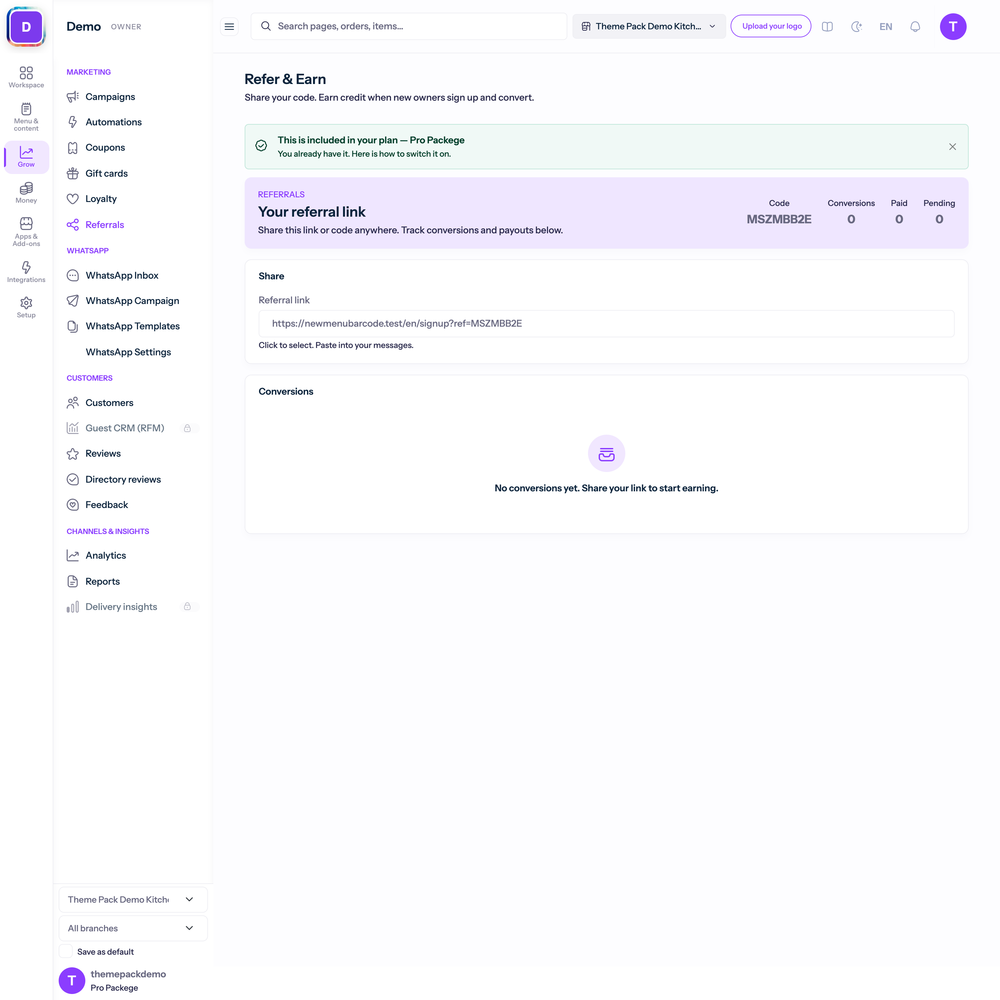

# Referral program



The referral program rewards you — the restaurant owner — for bringing new
owners onto the platform. You get a personal referral code and share link;
when someone signs up through it, the signup is credited to you and a reward
is queued for review by the platform team. This is separate from the
[loyalty program](loyalty.md), which rewards your own customers for repeat
orders.

## Opening the referral page

Click **Referrals** in the dashboard sidebar (share icon). The page is
titled **Refer & earn** and lives at `/referral`. It is available to every
owner account — there is nothing to enable or configure first.

Your referral code is created automatically the first time you open the
page (or the first time you sign up), so you always have one ready.

## Your code and link

The header strip shows your personal **code**: eight characters, letters
and numbers, unique to you (for example `K7KQ2M9F`). Below it, the
**Share** card holds your full referral link in a read-only field — click
the field to select it, then copy and paste it into messages, social posts
or emails.

The link is the platform signup page (`/signup`) with your code attached
as a `ref` parameter:

```
https://your-platform.example/signup?ref=YOURCODE
```

Anyone can also type the code by hand — appending `?ref=YOURCODE` to the
signup page address works the same as clicking your link. Before you share,
open the pre-filled link once to confirm it lands on the signup page; if it
does not, share the `/signup?ref=YOURCODE` form above instead.

## How referrals are tracked

1. **Click** — when someone opens the signup page with a valid referral
   code, the click is counted and the code is remembered in their browser
   for **30 days**. They do not have to sign up right away.
2. **Signup** — if they register within those 30 days (on the same browser
   and device), a **conversion** is recorded against your code. The
   remembered code is cleared after it is used.
3. **One conversion per new account** — a new user can only ever be
   attributed once, and you cannot refer yourself.

If the visitor clears their cookies, switches browsers, or signs up more
than 30 days after clicking, the signup is not attributed.

## Rewards and statuses

Each conversion starts as a pending credit reward (the amount is set by
the platform — currently a fixed credit per signup, the same for every
referrer; it is not something you can change). From there the platform
admin reviews it:

- **Pending** — recorded, waiting for platform review.
- **Approved** — accepted by the platform; it counts toward your earnings.
- **Paid** — the credit has been paid out to you.
- **Rejected** — declined (for example, suspected abuse); it earns nothing.

Payouts are handled manually by the platform team — approving a conversion
does not instantly add money to your account. If you have approved
conversions and have not received the credit, contact platform support.

## Reading your stats

The header strip on the referral page shows four live numbers:

- **Code** — your referral code.
- **Conversions** — total signups attributed to you, across all statuses.
- **Paid** — how many conversions on the current page are paid out.
- **Pending** — how many on the current page are still awaiting review.

Below the share card, the **Conversions** table lists every attributed
signup, newest first, 20 per page:

- **New user** — the username of the account that signed up.
- **Reward** — the credit amount attached to that conversion.
- **Status** — the badge described above.
- **Date** — how long ago they signed up.

Until your first conversion the table shows "No conversions yet. Share
your link to start earning."

## Tips

- Share the full link rather than the bare code — the link records the
  click and stores the attribution automatically.
- Referred signups only count for brand-new accounts. Inviting your own
  staff to an existing restaurant (see [Staff accounts](staff.md)) is not
  a referral.
- The referral code used inside Menu Studio for bonus AI credits is a
  separate system and does not appear on this page.

## Related pages

- [Getting started](getting-started.md) — what a new owner sees after
  signing up through your link.
- [Loyalty stamps](loyalty.md) — rewards for your customers, not for you.
- [Coupons](coupons.md) — discount codes for orders on your own menu.
