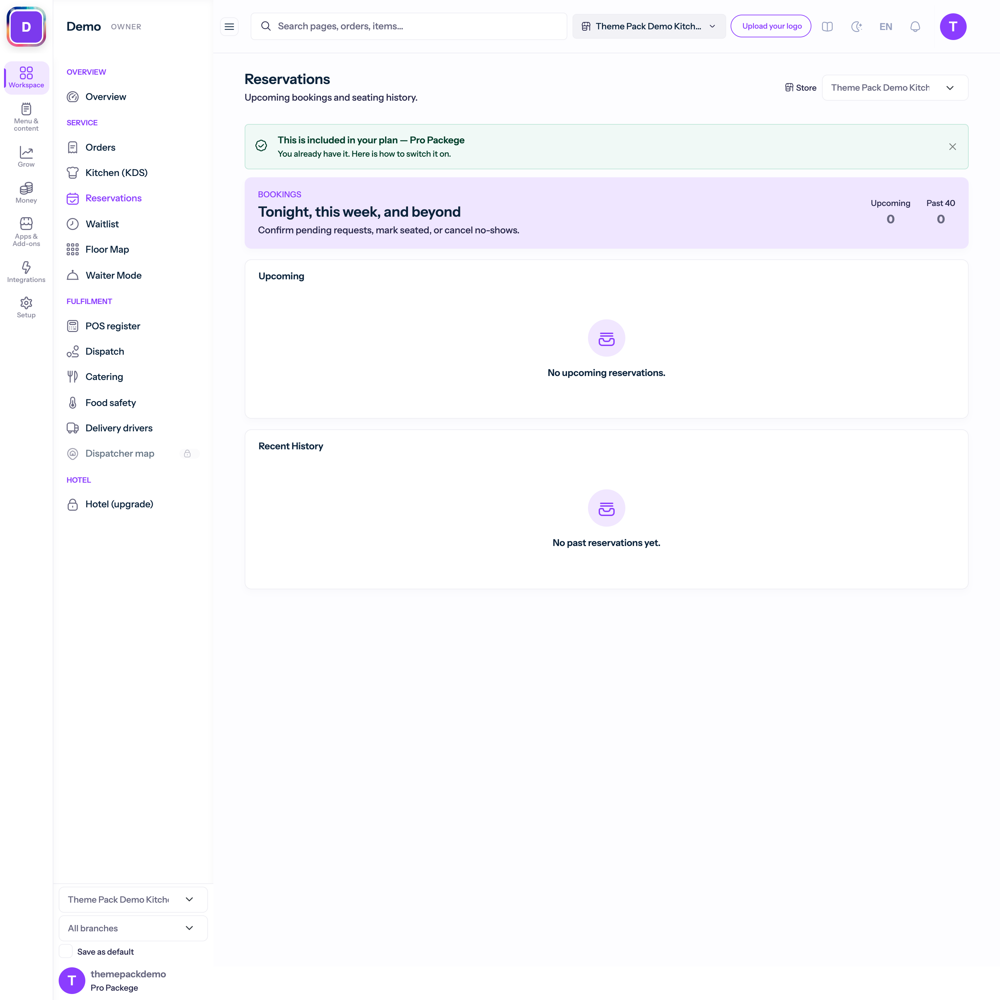

# Reservations

The Reservations page collects table booking requests from your public menu
and lets you manage them through their lifecycle: review the request, seat the
party when they arrive, or cancel a no-show. This guide covers where bookings
come from, what each status means, and what you can do from the dashboard.

## Where to find it

Click **Reservations** in the dashboard sidebar (the calendar icon, just below
Customers and above Waitlist). The page is owner-only and shows only
restaurants that belong to your account.

At the top of the page:

- If you have more than one restaurant, a dropdown in the top-right corner
  switches which restaurant's reservations you are viewing.
- If the selected restaurant has branches, the branch you have picked in the
  sidebar context switcher filters the lists too — you only see bookings for
  the current branch. See [Branches](branches.md) for how the switcher works.

A header strip shows two counters: how many upcoming reservations you have, and
how many past ones are in the history list below.

## How reservations arrive

Guests book from your public menu page: a **Reserve a table** booking flow
where the guest enters their name, phone, email, date and time, party size
(up to 50), and an optional note. Submitting creates a reservation in
**pending** status and shows the guest a confirmation on the spot.

Two things to know about public booking:

- It is opt-in per store and off by default. Turn it on with the **Accept
  table reservations** setting on the restaurant's edit page. All seventeen
  modern menu templates render the booking flow once it is on — see the
  [theme capability matrix](theme-capability-matrix.md).
- The booking form is rate-limited (10 submissions per minute per visitor,
  plus a per-branch limit) to prevent abuse, and only accepts dates in the
  future.

Guests are not sent an automatic confirmation email or SMS — the sheet tells
them "We'll confirm your booking shortly", so it is up to you to contact them
using the phone or email they left.

## The reservations page

The page has two lists:

- **Upcoming** — every future reservation that is still live (pending or
  confirmed), sorted soonest first. Each row shows the guest's name and phone,
  the date and time, the party size, a table column, the status badge, and
  quick action buttons.
- **Recent history** — the last 40 reservations that are in the past or already
  resolved (seated, cancelled, or no-show), newest first.

Status badges are colour-coded: confirmed is green, pending is amber, seated is
blue, and cancelled or no-show is red.

## Statuses

A reservation is always in one of five statuses:

- **Pending** — a fresh request from the public booking form, waiting for you
  to act on it. Pending bookings still count as upcoming.
- **Confirmed** — accepted. Reservations created through the dashboard's own
  add endpoint get this status automatically.
- **Seated** — the party arrived and was seated. This closes the booking and
  moves it to history.
- **Cancelled** — the booking will not happen.
- **No-show** — the party never arrived. Like cancelled, it moves the booking
  to history.

## Updating a reservation

Each row in the Upcoming list has two quick action buttons:

- **Seated** — press when the party arrives. The row moves to Recent history.
- **Cancelled** — press to cancel the booking.

Those are the only two buttons on the page. There is no separate "confirm"
button for pending requests — a pending booking simply stays in the Upcoming
list until you seat or cancel it, so treat pending rows as your to-do list for
the shift. (The underlying status endpoint does also accept confirmed and
no-show values, but the current page does not expose buttons for them.)

You cannot edit a reservation's guest details, time, or party size after it is
created, and there is no way to add a reservation manually from this page — see
the list below.

## Table assignment

The Upcoming list has a **Table** column. It shows a table number when one was
recorded with the booking, and a dash otherwise. Public bookings never include
a table, so in practice this column is usually empty.

There is currently no control on the page for assigning or changing a table,
and reservations are not linked to the tables on your [floor map](floor-map.md)
in the interface — that connection is planned but not wired up yet. If you want
to track which table a party should get, keep a note at the host stand for now.

## Not yet available

The following are planned or partially wired in the code, but you will not find
them in the dashboard today:

- A form to add a walk-in or phone reservation manually. The server endpoint
  exists (and marks such bookings confirmed automatically), but no page in the
  dashboard offers the form yet.
- Automatic confirmation emails or SMS to the guest. An email template exists
  in the codebase but nothing sends it.
- Availability rules — opening hours, time slots, or a cap on covers per slot.
  The public form accepts any future date and time, so double-bookings are
  possible and you should review pending requests promptly.
- Assigning reservations to real floor-map tables, including the built-in
  double-booking guard (no two active bookings on one table within 90 minutes).
  The logic exists server-side but is not connected to any screen.
- Reservation reminders before the booking time.

## Related pages

- [Theme capability matrix](theme-capability-matrix.md) — the menu templates
  that render the booking flow.
- [Floor map and tables](floor-map.md) — your dining room layout and live table
  statuses.
- [Waitlist](waitlist.md) — queue walk-in parties when the room is full.
- [Branches](branches.md) — how the branch context switcher scopes what you
  see.
- [Orders](orders.md) — on-table orders once the party is seated.
