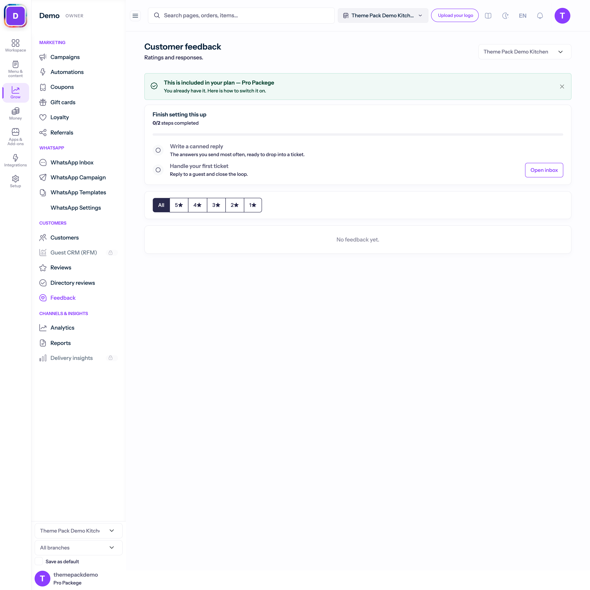

# Reviews, ratings and feedback

This page covers the three ways diners can rate your food and share feedback: per-item star ratings you moderate, a post-order prompt that sends happy diners to your Google review page, and a short "how likely are you to recommend us" (NPS) survey shown after checkout.

These are separate features with different homes in the dashboard. Read the sections below to see which are fully wired to your storefront today and which are collected in the background.

## Item ratings and reviews

Each menu item can carry a real average star rating (1 to 5) plus a count, stored on the item and shown on the menu card. Reviews are recorded in a `menu_reviews` table and can be moderated by you.

How a rating is stored when submitted:

- The score is clamped to 1-5.
- Any review text is stripped of HTML and trimmed to 500 characters.
- A session fingerprint (IP + browser + item) blocks the same visitor from rating the same item twice.
- New reviews are saved as approved immediately, and the item's average and count are recalculated straight away.

Because reviews auto-approve, the item's public rating updates without you doing anything. You moderate after the fact by rejecting anything unwanted (see below), which recomputes the average.

Important: the diner-facing widget that lets a customer actually submit an item review is not wired into the storefront templates yet. The submit endpoint (`POST {store}/review`, route `restaurant.submitReview`) and the button labels exist, but no theme currently renders a rating form for diners. In practice, item averages stay empty until this widget is added, or until ratings are created another way. The moderation screen and the average-on-card display are both built and ready for when it lands.

## Moderating reviews

Open Reviews from the left sidebar (the star icon). It opens the reviews screen for your restaurant at `stores/{store}/reviews`.

The page shows:

- A summary strip with average rating and pending / approved / rejected counts (counts reflect the current page of results).
- A list of reviews, 20 per page, newest first, each showing the menu item, the star score, the review text, a status badge, and how long ago it was left.

For each review you can:

- Approve — marks it approved and includes it in the item's public average.
- Reject — marks it rejected and removes it from the average.

Approving or rejecting recalculates that item's `rating_avg` and `rating_count` from the remaining approved reviews, so the public menu card updates immediately.

Review text is stored in the `body` field throughout (submission, storage,
and moderation display), so the star score and written comment both appear
correctly on the moderation screen.

## Where ratings show to diners

On the customer menu, item cards read the stored `rating_avg` / `rating_count`. Behaviour differs by theme: some themes (for example Vivid and Velvet) show a real rating only when one exists and hide it otherwise, while a few older themes still fall back to a decorative placeholder number when an item has no real ratings. If you want a specific theme audited for this, see [Themes](themes.md).

## Post-order Google review prompt

After a diner completes an order, the storefront can show a friendly "Enjoying your meal? Leave us a review" card with a button that opens your Google (or other) review page in a new tab. It only appears if you have set a review link.

To set it up:

1. Go to your restaurant's edit form (Restaurants, then edit the restaurant).
2. Find the Google review URL field and paste the full link to your review page.
3. Save.

Once set, the review card appears on the order-success screen in the Aurora, Classic, Modern and Orange themes. Not every storefront theme renders it — if yours does not, the card simply will not show. The link opens in a new tab and does not interrupt the checkout, payment or WhatsApp flow — there is no auto-redirect, just a button. Leave the field blank to hide the card.

## Post-dining NPS survey

The order-success screen in the Aurora, Crave, Glow and Matcha themes also shows a short survey: "How likely are you to recommend us?" with buttons from 0 to 10. When a diner taps a number:

- The score is saved to an `nps_responses` table against your restaurant.
- A per-day session fingerprint prevents the same visitor submitting more than once per day.
- The widget replaces itself with a thank-you message. In the Aurora theme this message varies by score (warmer for high scores, apologetic for low scores); the other themes show a single fixed thank-you line.

The survey endpoint (`POST {store}/nps`, route `restaurant.submitNps`) also accepts an optional comment, though the survey widgets currently send only the score.

Note: NPS responses are collected and stored, but there is no owner-facing NPS summary or report in the dashboard yet. There is currently no built-in screen to view the average score or the collected comments. If you need this data, it is only available directly from the database for now.

## Rate limiting

Both the review and NPS submit endpoints are throttled to protect against spam and automated submissions. Combined with the once-per-session and once-per-day fingerprints, this keeps repeat submissions out.

## A note on the public feedback page

The platform's own "/feedback" page (in the main site navigation) is a general contact form that emails your configured contact address. It is separate from diner ratings and the NPS survey described above, and is not tied to any specific restaurant or order.

## Related pages

- [Menu items](menu-items.md) — where item ratings appear on cards.
- [Themes](themes.md) — which storefront theme renders the order-success prompts.
- [Orders](orders.md) — the checkout flow the review and NPS prompts follow.
- [Customers](customers.md) — capturing diner contact details at checkout.
