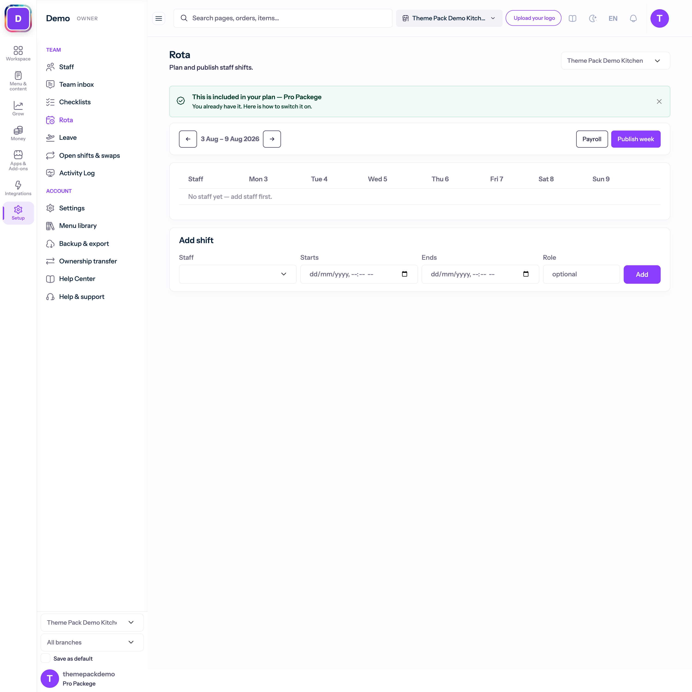

# Staff scheduling (rota)

The rota is a week grid: one row per staff member, one column per day. You add
shifts, publish the week, and only then do your staff see it. A companion page
handles open shifts, claims and swaps.

Both pages are linked from the sidebar's **Team** group when their feature is
on: **Rota** (the week grid, also at `/rota`) and **Open shifts & swaps**
(also at `/rota-plus`).

Both pages are gated. The rota needs the **Staff Rota & Scheduling** feature
(`staff_rota`) switched on for your account; open shifts and swaps sit behind
the **Team Chat** feature (`team_comms`). If a feature is off you get a "not
included in your current plan" message or the upgrade page instead of the
screen. See [Plans and billing](plans-billing.md).

Staff must exist before you can schedule them — add them on the
[Staff](staff.md) page first.

## The week grid

Open `/rota`. If you own more than one restaurant, pick which one from the
dropdown at the top right; the page reloads for that restaurant.

The header strip shows the week you are looking at (Monday to Sunday) with
**←** and **→** arrows to step a week back or forward, a **Payroll** link, and
the **Publish week** button.

The grid below lists every staff member of the selected restaurant with their
role underneath, and seven day columns. Each shift appears in its day cell as
`HH:MM–HH:MM`. Published shifts are shaded green; unpublished ones are plain
with a border, so you can see at a glance what your team has and has not been
told about. The **×** on a shift deletes it immediately.

If the restaurant has no staff yet you see "No staff yet — add staff first."

## Adding a shift

The **Add shift** card at the bottom of the page takes:

- **Staff** — chosen from the staff of the selected restaurant.
- **Starts** and **Ends** — date and time pickers. The end must be after the
  start.
- **Role** — optional free text, up to 32 characters (for example "bar",
  "close"). This is the role recorded on the shift, separate from the staff
  member's own role.

Overnight shifts are fine — just set the end date to the next day.

Overlaps are allowed but flagged: if the new shift overlaps another shift for
the same person, the confirmation reads "Shift saved — note: it overlaps
another shift for this staff member." Back-to-back shifts (one ends exactly
when the next starts) do not count as an overlap.

There is no edit form — to change a shift, delete it with the **×** and add it
again.

## Publishing the week

New shifts are created unpublished. Staff never see an unpublished shift.

**Publish week** publishes every shift whose start falls in the week you are
currently viewing (Monday 00:00 to Sunday 23:59) for the selected restaurant.
The confirmation tells you how many shifts were published. Publishing again
after adding more shifts is safe — it simply publishes everything in that week.

Once published, a staff member's shifts are available to the staff app, which
serves the shifts starting from today through the next 14 days. This is a data
endpoint (`/staff-app/shifts`); there is no rota screen in the staff app itself
yet. See [Staff app](staff-app.md).

## Open shifts, claims and swaps

`/rota-plus` is the approvals console for shifts that are not simply assigned.
It has three panels for the selected restaurant:

- **Pending claims** — shifts that someone has claimed, shown as the shift's
  start time and the claiming staff id. **Approve** moves the shift to that
  person, closes it, and marks the claim approved.
- **Open shifts** — shifts currently released to the pool, with their claim
  status badge if one exists.
- **Swap requests** — swaps in the requested or accepted state, shown as the
  shift id, the requesting staff id and the target staff id. **Approve** appears
  only on an *accepted* swap; approving reassigns the shift to the target staff
  member.

Behind the scenes the system also records staff availability per weekday
(preferred / unavailable) and can warn when a shift lands on a day someone is
unavailable or on approved leave.

### What is not built yet

- **No "open this shift" button.** The endpoint that releases a shift to the
  pool exists, but neither the rota grid nor `/rota-plus` renders a button that
  calls it. In practice the pool fills only if shifts are opened another way.
- **No staff-facing claim or swap screen.** Claiming an open shift, accepting a
  swap, and setting availability are all implemented in the backend, but the
  staff app does not yet expose them — so `/rota-plus` may stay empty.
- **Availability has no screen.** Availability is stored and used for conflict
  warnings but there is no page to enter it.

## Payroll report from the rota

The **Payroll** button on the rota (or `/rota/payroll` directly) opens a
read-only report. It moves no money — it is a summary you export.

Pick a **From** and **To** date (defaults: the start of this month to today)
and press **Run**. For every staff member of the selected restaurant you get:

- **Scheduled h** — hours from rota shifts starting in the period.
- **Worked h** — hours from completed clock-in/clock-out pairs. If someone is
  still clocked in, that pair is not counted and an orange "open" badge shows
  how many unfinished pairs there are.
- **Rate** — the staff member's hourly rate.
- **Pay** — worked hours × rate.
- **Tips** — tips on orders served by that staff member in the period.

**Export CSV** downloads the same table as
`payroll_<from>_<to>.csv`, with the columns Staff, Role, Scheduled hours,
Worked hours, Open clock pairs, Rate, Pay, Tips.

This report is separate from the full pay-run workflow — see
[Payroll](payroll.md).

## Related pages

- [Staff](staff.md) — create the staff members you schedule.
- [Staff app](staff-app.md) — where published shifts are delivered.
- [HR and employee files](hr-employees.md) — leave, which conflicts with shifts.
- [Payroll](payroll.md) — pay runs, payslips and tip pooling.
