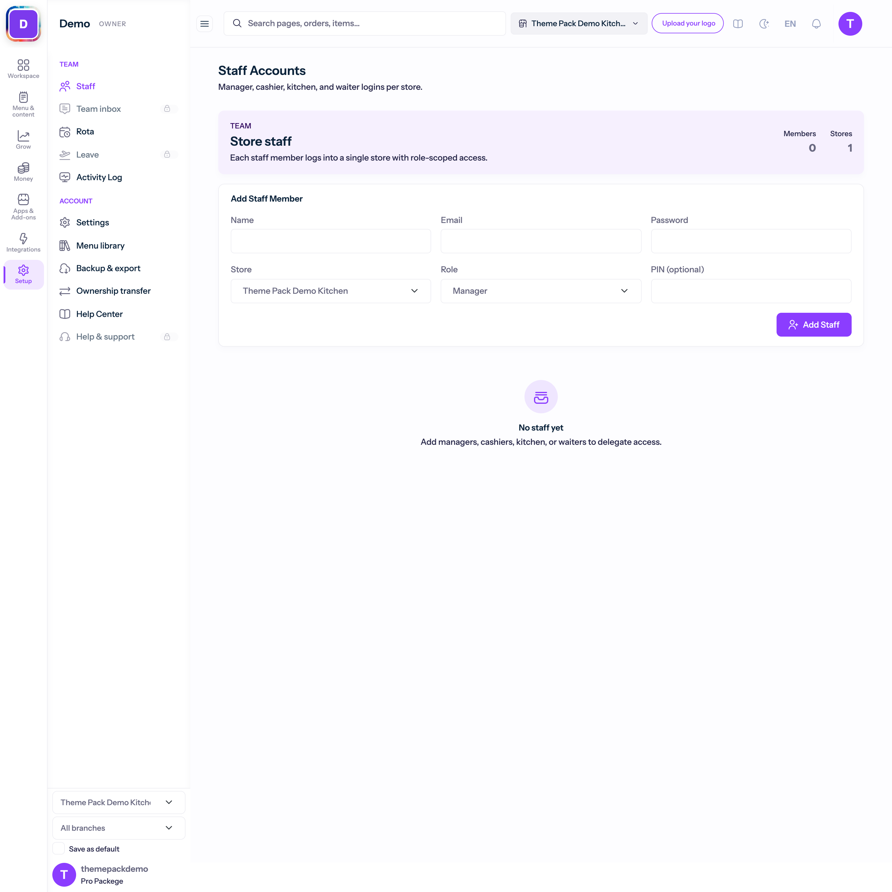

# Staff and roles

Staff accounts let you give your team their own logins instead of sharing your owner password. Each staff member belongs to one restaurant, signs in with their own email and password, and only sees the parts of the dashboard their role allows. You always keep full owner access; staff get a scoped-down view of the same dashboard.

You manage staff from the **Staff** item (users icon, under the **Team** group) in the dashboard sidebar.

## Adding a staff member

Open **Staff** in the sidebar. If you have not created any restaurants yet, the add form does not appear — create a restaurant first. Otherwise, fill in the **Add staff member** form:

- **Name** (required) — up to 80 characters.
- **Email** (required) — must be unique across all staff accounts. This is what they log in with.
- **Password** (required) — at least 6 characters. Share it with the staff member; they use it to sign in.
- **Restaurant** (required) — the single restaurant this person can work in. Staff are locked to one restaurant.
- **Role** (required) — Manager, Cashier, Kitchen, or Waiter. See the table below.
- **PIN (optional)** — a 4 to 6 digit number used for quick sign-in on shared POS/kitchen tablets (see [PIN sign-in](#pin-sign-in)).

Click **Add Staff** to create the account. New staff are active immediately.

Existing staff are listed below the form, grouped by restaurant, showing name, email, role, and whether the account is active. To remove someone, use the **Remove** button on their row and confirm. Removing a staff member revokes their access right away.

Depending on what is enabled for your store, a row also carries a **Folio access** switch (hotel features — see below) and an **HR file** link (HR suite). There is no general edit form on this page today — to change a person's name, role, PIN, or password, remove the account and add it again.

## Roles and what each can see

A role is a fixed bundle of permissions. When a staff member is signed in, the sidebar hides sections they are not allowed to use, and the server also blocks direct links to those pages (they get a "forbidden" error), so a role limit cannot be worked around by typing a URL.

| Role | Can access |
| --- | --- |
| **Manager** | Orders, menu editing, coupons, analytics, KDS, customers, POS (including refunds and closing shifts), and hotel folios (on hotel-enabled stores) |
| **Cashier** | Orders, KDS, and POS |
| **Kitchen** | KDS only |
| **Waiter** | Orders and POS |

What each permission unlocks in the dashboard:

- **Orders** — the Orders list: viewing orders, updating status, completing, and deleting.
- **Menu editing** — opening a restaurant's edit screen, the QR builder, editing categories and menu items (including AI generation, CSV import/export, variants and extras), and saving restaurant settings.
- **Coupons** — the coupons area.
- **Analytics** — the analytics dashboard, exports, and reviews.
- **KDS** — the Kitchen Display System (see [Kitchen display](kds.md)).
- **Customers** — the customer list, customer details, and exports.

Managers, cashiers, and waiters also carry POS access, which governs the point-of-sale terminal and (for managers) refunds and shift close. POS is opened from the **POS** launcher rather than a normal dashboard page — see [Point of sale](pos.md).

Anything not listed for a role is blocked. For example, a kitchen staffer cannot open Orders, Analytics, or restaurant settings. Staff also cannot open the Staff management page itself — only the owner can add or remove team members.

## Folio access (hotel stores)

On stores with hotel features enabled, each staff row on the **Staff** page shows a **Folio access** switch. It grants or revokes the `hotel_folio` permission for that person — the permission that gates the guest-folio money screens and actions: the stays list and statements, check-in, settling charges, and check-out/write-off.

**Managers hold folio access by default** (like refunds and shift close); cashiers, waiters, and kitchen staff do not. Flip the switch on a row to grant it to a non-manager, or to take it away from a manager. Without the permission, a staff member gets a "forbidden" error on the folio screens, and the **Stays** navigation entry is hidden.

See [Hotel stays and charge-to-room folios](hotel-folios.md) for the folio workflow itself.

## What staff can see across restaurants and branches

A staff member is tied to exactly one restaurant and can only see that restaurant's orders, menu, and reports. Trying to open another restaurant's data returns a "forbidden" error, even by direct link. This keeps each team scoped to where they work.

Staff share the same dashboard shell as you, but their store switcher is fixed to their assigned restaurant. Branch-level pinning exists in the underlying data but is not set from the current Add staff form, so staff see all branches of their restaurant by default.

## How staff log in

Staff use a separate login page from the owner login:

- **Staff login:** `/staff/login`

They enter their staff email and password (with an optional "remember me"). On success they land on the normal dashboard at `/dashboard`, restricted to their role. If the email or password is wrong, or the account has been removed, they see the message "Invalid staff credentials or inactive account."

Behind the scenes, signing in as staff also loads the owner's workspace so the dashboard has the right data, but the staff member only ever sees their permitted sections. Their last sign-in time is recorded.

To sign out, staff use the logout action, which returns them to the staff login page. The old `/staff/portal` address is not a real destination — visiting it just redirects to the dashboard.

Staff never use the owner login form. If a staff member cannot get in, check that: the account still exists in your Staff list, the email and password are correct, the account is active, and they are using `/staff/login` rather than the main owner login.

## PIN sign-in

The optional PIN is a 4 to 6 digit code for fast sign-in on shared devices — a kitchen tablet or a POS terminal that many staff share. PINs only need to be unique within a single restaurant. PIN sign-in is used by the staff app and POS terminal, not by the web dashboard login (which always uses email and password). If you leave the PIN blank, the staff member simply signs in with their email and password everywhere.

For the mobile staff experience (orders, KDS, clock-in, tips) that also uses these accounts, see [Staff app](staff-app.md).

## Related pages

- [Hotel stays and charge-to-room folios](hotel-folios.md) — the folio screens the **Folio access** switch gates.
- [Staff app](staff-app.md) — the mobile PWA staff use for orders, KDS, and clock-in.
- [Point of sale](pos.md) — the POS terminal staff sign into.
- [Kitchen display](kds.md) — the KDS screen for kitchen and manager roles.
- [Orders](orders.md) — the order list staff with the Orders permission work from.
- [Activity log](activity-log.md) — a record of actions, including when staff are created.
