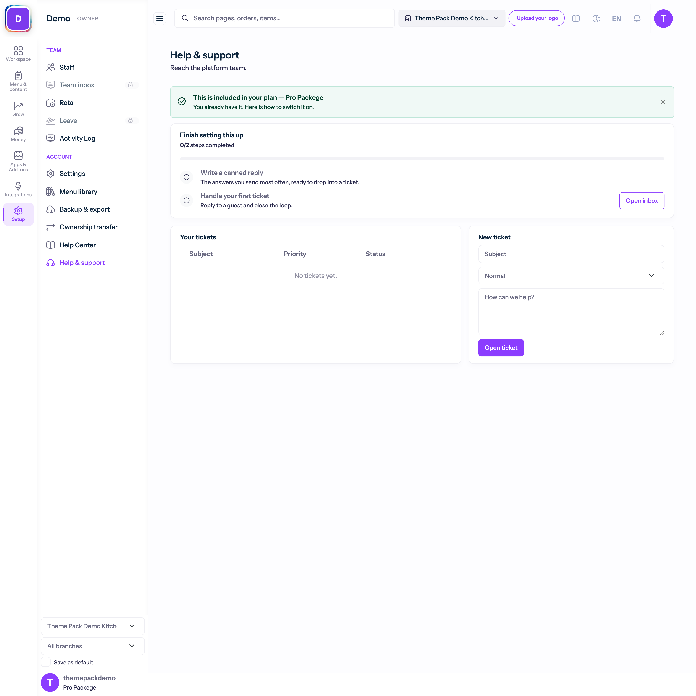

# Support tickets and the feedback inbox

Two related screens ship together behind the same feature:

- **Help & support** — your own tickets to the platform team.
- **Feedback** — the post-order survey ratings your diners leave you.

Both are paid features. If your plan does not include them, the sidebar shows
locked entries instead of the pages.

---

# Help & support (tickets to the platform)

Use this when you need the people who run the platform, not your customers.

## Opening the page

Click **Help & support** in the sidebar under **Setup → Account**. The page is
titled **Help & support** and lives at `help`. It is per **account**, not per
restaurant — there is no store selector, and you only ever see tickets you
opened.

## Opening a ticket

In the **New ticket** panel:

- **Subject** — required, up to 180 characters.
- Priority — **Low**, **Normal** (the default), **High** or **Urgent**.
- **How can we help?** — required, up to 4,000 characters.

Click **Open ticket**. You are taken straight to the ticket thread, and the
ticket starts with status **open**.

## The thread

**Your tickets** lists every ticket you have opened, newest first, with its
subject, priority and status. Click a subject to open the thread.

The thread shows each message with **You** or **Support** as the author and how
long ago it was sent. A reply box sits at the bottom — type and click **Send**
(up to 4,000 characters). Replying puts the ticket back to **open**.

Once a ticket is **resolved** or **closed** the reply box disappears; open a new
ticket if you need to continue.

Support staff can leave internal notes on your ticket. Those are never shown to
you — you only see the messages addressed to you.

---

# Customer feedback inbox

The feedback inbox collects star ratings from the post-order survey and lets you
reply to each one or close it off.

## Where the ratings come from

The platform creates a feedback request for each **completed or delivered** order
placed by a signed-in customer, a couple of hours after the order finishes. The
sweep runs hourly and looks back three days, and it only ever creates one
request per order. Guest orders never generate a request.

The customer gets a private survey link. On the survey they pick 1 to 5 stars
and can add a comment of up to 2,000 characters. A link can only be used once —
returning to a completed survey shows "This survey was already completed."

After they submit:

- **4 or 5 stars** — they are sent on to your public review link, if you have
  set one for that restaurant.
- **1 to 3 stars** — they stay on a private thank-you page, and the rating
  comes to you rather than to a public listing.

Ratings of 1 or 2 stars are also written to the [activity log](activity-log.md)
as a low-rating signal.

## Opening the inbox

Click **Feedback** in the sidebar under **Grow → Customers**, or go straight to
`/customer-feedback`. The page is titled **Customer feedback**; use the store
selector in the page header to switch restaurant.

You see up to 100 answered ratings for that restaurant, most recently submitted
first. Filter buttons across the top show **All** or a single star rating from
5★ down to 1★. Requests the customer never answered are not listed.

Each card shows the star rating, how long ago it was submitted, the order
number, the customer's comment, and your reply once you have written one.

## Replying and closing

On any card that is not closed:

- Type in the **Reply…** box and click **Send**. Your reply is saved on the
  feedback (up to 2,000 characters) and shown back on the card as "You
  replied". Sending again overwrites the previous reply.
- Click **Close** to mark the feedback dealt with. A closed card shows a
  **Closed** badge and loses both the reply box and the close button.

## Scope and limits

- Feedback is scoped to your own restaurants; another owner's feedback returns
  "not found".
- Your reply is stored on the record for your team. It is not emailed back to
  the diner from this page.
- Closing is one-way from this page — there is no reopen button.

## Related pages

- [Reviews, ratings and feedback](reviews-feedback.md) — item reviews, review
  moderation, the Google review prompt and the NPS survey.
- [Orders](orders.md) — the orders that trigger a survey.
- [Customers](customers.md) — the diners behind the ratings.
- [Activity log](activity-log.md) — where low-rating signals are recorded.
