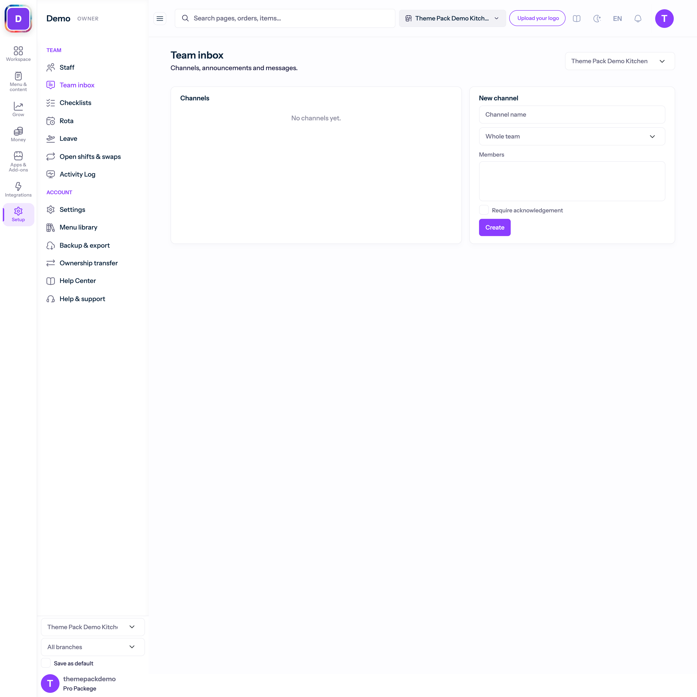

# Team inbox, checklists and shift notes

The team inbox is internal messaging for your restaurant: channels for the whole
team, smaller groups, or one-way announcements. The same feature adds daily
opening/closing checklists and a shift-handover notes board.

These pages need the **Team Chat** feature (`team_comms`) enabled for your
account; without it you get "not included in your current plan" or the upgrade
page. See [Plans and billing](plans-billing.md).

There are no sidebar links. Go directly to:

- **Team inbox** — `/team`
- **Checklists & shift notes** — `/team/checklists`

Use the restaurant dropdown at the top right of the inbox if you own more than
one restaurant.

## Channels

`/team` lists your channels, most recently active first, each with its type
badge and a red count of messages you have not read. "No channels yet." shows
when there are none.

The **New channel** card creates one:

- **Channel name** — up to 120 characters.
- **Type** — **Whole team**, **Group**, or **Announcement**.
- **Members** — a multi-select of the restaurant's staff. Hold Ctrl (Cmd on a
  Mac) to pick several. You are always a member of every channel you create.
- **Require acknowledgement** — flags the channel as one where staff are
  expected to acknowledge messages, not just read them.

Channels cannot be renamed, archived or deleted from this page, and members
cannot be added after creation.

## Reading and posting

Click a channel to open its thread. Messages appear oldest first, each with the
sender ("You" for your own messages, otherwise the staff id) and how long ago it
was sent. Opening a thread marks everything in it as read for you, so the unread
badge clears.

The box at the bottom posts a message — up to 4000 characters — with **Send**.
Posting bumps the channel to the top of the inbox list.

Messages are plain text. There are no attachments, editing, deleting or
reactions on this page, and staff names are shown as ids rather than names in
the thread.

## Checklists

`/team/checklists` runs your recurring opening, closing and daily tasks. The
date picker at the top right chooses the day; it defaults to today and reloads
on change.

Opening the page for a date creates that date's checklist runs from every active
template, so today's lists are simply there when you arrive. Doing this twice
does not duplicate anything.

**Today's checklists** lists each run with its template name, a percentage badge,
and one line per task. Click the circle to tick a task off, and click again to
untick it; who ticked it and when is recorded. If nothing is scheduled you see
"No checklists for this date."

### Creating a template

The **New checklist template** card takes:

- **Name**
- **Schedule** — **Opening**, **Closing** or **Daily**
- **Items** — one task per line in the text box; blank lines are ignored.

Press **Create**. The template starts generating runs from the next date you
open the page. Templates cannot be edited or deleted here, and the schedule is a
label — every active template generates one run per date regardless of which
schedule you picked.

## Shift notes

The **Shift notes** card on the same page is a handover board for the selected
date. Existing notes for that date are listed newest first; the box below adds
one (up to 2000 characters) with **Add note**. Notes are tied to the date shown
in the picker. They cannot be edited or deleted.

## What staff see

The channels, checklists and notes described here are all managed from the owner
dashboard. The staff-facing side of team chat — staff reading channels,
replying, acknowledging announcements, or ticking checklists from their phone —
is not exposed in the staff app yet, so today this is best treated as an
owner-and-manager record rather than a two-way conversation with your team.

## Related pages

- [Staff](staff.md) — the staff members you add to channels.
- [Staff scheduling](staff-scheduling.md) — open shifts and swaps, which use the
  same Team Chat feature.
- [Staff app](staff-app.md) — what your team can do from their phones.
- [Plans and billing](plans-billing.md) — enabling the Team Chat feature.
