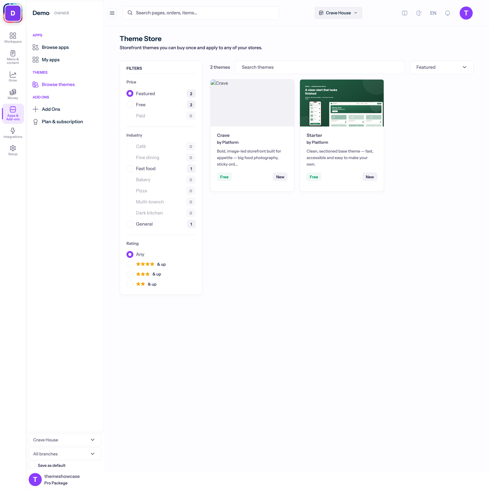

# Storefront themes and customizer

Your public menu's look is controlled in three places: the template picker on
the restaurant edit page (which layout your menu uses), the theme customizer
in the sidebar (colours, fonts, texts and sections for templates that support
it), and the theme marketplace (third-party themes you can buy and apply).
This guide covers all three, plus light/dark mode, custom fonts and seasonal
accents.

## Choosing a menu template

Every restaurant renders through one template. You pick it when you create
the restaurant, and you can change it at any time:

1. Go to **Stores** in the sidebar and open the restaurant's edit page.
2. Open the **Design** tab and find the **Images and template** section.
3. The template gallery shows each available template as a card with a
   preview image, name and short description. Click a card to select it,
   then save.

Switching templates never touches your menu data — items, categories, photos
and orders all stay put. Only the public page's layout changes.

Notes:

- The list you see is curated by the platform. If a template is retired from
  the picker, restaurants already using it keep rendering it — you are never
  forced off a template you chose.
- Marketplace themes are applied from the marketplace page rather than this
  gallery (see below). A restaurant running a marketplace theme keeps its
  choice in the same place, so everything else on the edit page works the
  same.
- The gallery only shows templates built for your [store type](store-types.md):
  a Restaurant sees the food templates below; a Retail, Cosmetics, Clothing,
  Car parts or Pharmacy store instead sees **Shelf**, a grid layout for
  goods; a Laundry & services store sees **Booking**, a service list with a
  slot picker. Neither of the two is a marketplace theme, and neither
  supports the theme customizer described below yet.

## Themes for other kinds of business

**Shelf** and **Booking** are the platform's storefront themes for a goods
store and a services store, respectively (see
[Choosing your store type](store-types.md)). Shelf adds a Year/Make/Model
vehicle filter and OEM search for a Car parts store, and an age-confirmation
step for age-restricted items on a Pharmacy store; Booking shows your
services with a quantity or weight picker and your enabled
[fulfillment](fulfillment-methods.md) time slots. Both are picked the same
way as a food template, at store creation or from the edit page's template
gallery — you never choose between the two yourself, since the gallery
already only offers the one built for your store type.

## Theme customizer

Open **Theme customizer** in the sidebar (palette icon). This is a no-code
editor: you change values (colours, fonts, headings, toggles), preview them
privately, and publish when you are happy. All 17 first-party modern
templates support it, and marketplace themes bring their own settings groups
defined by the theme's developer.

The basics:

1. Pick a restaurant from the dropdown at the top of the page.
2. The left panel lists the theme's settings in groups behind an icon rail —
   colours, typography, content texts, section toggles and so on, with a
   search box that finds a setting across all groups. Changed settings show
   a count badge per group, every field has its own reset, and
   **Ctrl/Cmd-Z** undoes your last edits (up to 50 steps).
3. The right panel shows a live preview of your actual menu that updates as
   you type — no save needed to see a change. You can switch the preview
   between desktop and mobile, and between your menu's languages (including
   RTL languages like Arabic).
4. Changes are saved as a **draft** visible only to you. Click **Publish**
   to make them live; until then diners keep seeing the last published look,
   and you can discard the draft at any time. Navigating away with unsaved
   changes prompts you first.

Beyond the basics:

- **Presets and palettes.** Every theme ships ready-made presets with
  thumbnails — hover to preview one on your real menu, click to stage it as
  a draft (a preset never auto-publishes). A set of curated colour palettes,
  a shuffle button, and **palette from logo** (which extracts colours from
  your uploaded logo) give you fast starting points.
- **Contrast guard.** If a colour combination fails accessibility contrast,
  a warning banner names the pair and offers a one-click fix to the nearest
  passing shade. It warns — it never blocks a publish.
- **Click-to-edit.** Turn on select mode and click any section directly in
  the preview; the editor scrolls to and highlights that section's settings.
- **Section reorder.** Themes that render in sections can be reordered with
  drag handles (or keyboard up/down) in the **Sections** group.
- **Per-locale texts.** On themes that support it, text settings (headings,
  welcome lines) show a tab per menu language so each language gets its own
  wording, with sensible fallback when a language is left blank.
- **Media picker.** Image settings offer **choose from library** so you can
  reuse anything already in your [media library](media-library.md) instead
  of re-uploading.
- **Font pairs.** Typography offers curated self-hosted font pairs (all with
  Arabic support); fonts are served from the platform, not a third-party
  CDN.
- **Version history.** Every publish is snapshotted. A history panel lists
  versions, shows what changed between any version and now, and reverts with
  one click (the revert is staged as a draft, so you review before it goes
  live).
- **Export / import.** Download your theme settings as a JSON file and
  import them elsewhere; imports are validated against the theme and staged
  as a draft, with a report of anything that could not be applied.
- **Copy between stores.** Copy a store's look to another of your stores on
  the same theme family — again staged as a draft on the target store.

Everything you enter is treated as data and validated against the theme's
own settings schema — the customizer never accepts raw HTML, scripts or CSS,
so a theme cannot be broken (or abused) through it.

If your restaurant uses the Page View template, the customizer also shows a
**Menu display source** panel: display a booklet built from your live menu
data, or upload a print-ready PDF (up to 20 MB) to show as-is. When a PDF is
uploaded you can additionally click **Also import items to my menu** to have
the AI read the PDF and add its dishes as editable items items — existing
items are not replaced. See [AI menu generator](ai-menu-generator.md).

Your customizer settings are saved per restaurant and survive template
version updates on marketplace themes.

## Light and dark mode

On the restaurant edit page, under the **Design** tab in the **Images and
template** section, the **Theme mode** select offers **Auto**, **Light** and
**Dark**:

- **Auto** — the menu follows the diner's device setting.
- **Light** / **Dark** — forces that look for everyone.

The Aurora template supports this fully: it ships light and dark variants,
honours your Theme mode choice, and also shows diners a sun/moon toggle on the
menu itself. A diner's own toggle choice is remembered on their device and wins
over your default. Some other templates (such as Minimal) follow the diner's
device light/dark setting automatically but do not yet read the Theme mode
override, and some ship a single fixed look. For any customizer-enabled template
you can still adjust colours directly in the theme customizer.

## Fonts

Two ways to set your menu's typeface, both on the restaurant edit page under
the **Design** tab in the **Images and template** section:

- **Menu Font** — a curated dropdown of web fonts (Inter, Poppins, Lato,
  Montserrat, Roboto, Open Sans, Raleway, Nunito, Source Sans 3, Playfair
  Display, Merriweather, Dancing Script, Bebas Neue, Sora), or "Default
  (system font)".
- **Upload custom font** — upload your own brand font as a `.woff2` file, up
  to 2 MB. Only the woff2 format is accepted. Uploading a file replaces the
  dropdown choice; a **Remove** link next to the current file switches you
  back to the dropdown/default.

The chosen font is applied across the menu with a safe fallback: if the font
fails to load on a diner's device, the menu falls back to the system font
rather than breaking. Some customizer-enabled templates (such as Aurora)
also expose a body-font setting inside the theme customizer, which applies
to that theme's styled text.

## Seasonal skins

The Aurora template automatically applies subtle seasonal accent colours
during holiday windows — a festive red accent from 1 December to 6 January,
and a gold accent in early April as a Ramadan approximation. This is
automatic and date-based; there is currently no owner setting to force a
skin on, pick a different one, or turn the accents off, and other templates
do not apply seasonal skins.

## Theme marketplace

The marketplace at `/marketplace` (also linked from the site navigation)
lists third-party themes built by independent developers and reviewed by the
platform before publishing. Each theme page shows:

- the price (or **Free**),
- a **Live preview (demo store)** link — the theme rendered against sample
  data, so you can try it before buying without exposing your own menu,
- the purchase and apply controls (sign in first).

Buying and applying:

1. On the theme's page, click **Buy license** (paid themes). The price is
   charged to your account wallet — top up first if the balance is short.
   One purchase licenses your whole account: you can apply the theme to any
   number of your restaurants, and buying the same theme twice never charges
   you again. Free themes skip this step.
2. Pick a restaurant in the **Apply to this restaurant** dropdown and click
   apply. Your menu immediately renders with the theme's latest published
   version.

Marketplace themes are customized through the same theme customizer as
first-party templates, using the settings and sections the theme's developer
defined.

## Theme updates

Marketplace theme developers ship improvements as new published versions.
Updates are never forced onto your menu: your restaurant stays pinned to the
version you applied until you choose to move, and your customizer settings
are kept when you do — settings are stored independently of the version, by
design.

The platform exposes an owner endpoint that lists your restaurants with a
newer published version available and applies the update (optionally to a
specific published version rather than the latest). A dedicated dashboard
screen for this is not yet available; re-applying the theme from its
marketplace page also moves the restaurant to the latest published version.

## Related pages

- [Getting started](getting-started.md) — creating a restaurant, including
  the initial template choice.
- [QR codes and sharing](qr-codes.md) — where your public menu link lives.
- [AI menu generator](ai-menu-generator.md) — the PDF/photo import used by
  the Page View template's import button.
- Developers: building and submitting marketplace themes is covered in the
  developer docs at [Learn: themes](../dev/learn-themes.md).
