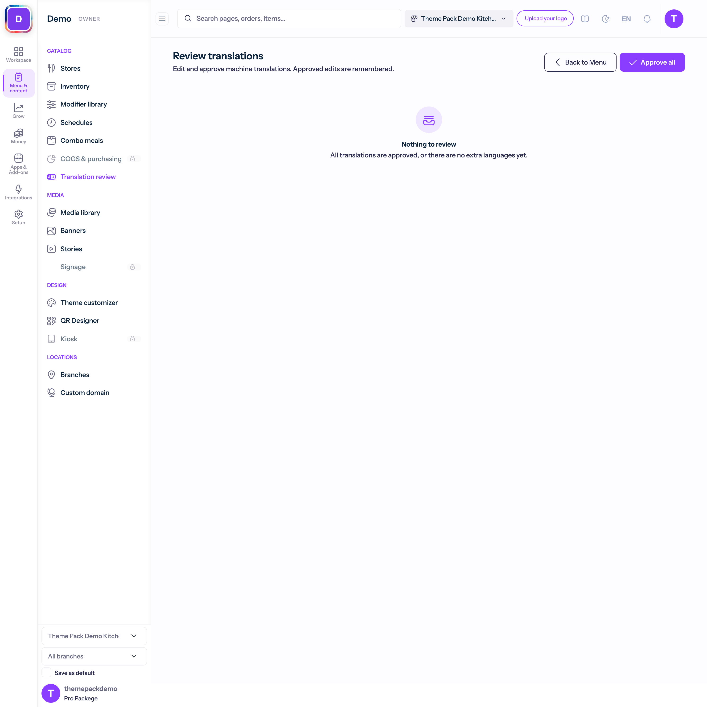

# Menu translations

Serve your menu in several languages. You write each item once in your own language, let AI fill in the other languages, then review and approve the results before diners see them. Right-to-left languages like Arabic are handled automatically.

## How translations work

Every category, item, item description, variant option, and extra stores its base text plus a set of translations keyed by language. Diners see the version that matches the language they pick on your public menu; if a translation is missing, they fall back to the base text.

You never manage translations field by field on the menu editor. Instead you:

1. Choose which languages your menu supports and which one is the default (the language your base text is written in).
2. Run AI auto-translate to fill the gaps.
3. Review and approve the machine translations.

## Choosing supported languages

Open a restaurant, go to Edit, then the Languages tab.

- Tick every language you want your menu offered in under the language list.
- Set Default Language to the language your item names and descriptions are actually typed in. This is your source language.

The list of available languages is controlled by the platform administrator, so you can only pick from the languages that have been switched on for the platform.

You also set your currency code, sign, and position on this same tab. Save the restaurant to store your choices.

## AI auto-translate

Once a restaurant has more than one menu language, a Translate missing button appears in the top actions of the menu editor (the Menu page for the restaurant).

1. Click Translate missing. A dialog opens titled "Translate menu with AI".
2. Confirm the field "My menu is currently written in" — this is the source language the AI translates from. It defaults to your saved default language.
3. The dialog shows which languages the missing translations will be filled into.
4. Click Start translation.

Important: pick the language your items are genuinely written in. If you translate from a language your menu is not written in, or from an empty menu, you get wrong or empty results. The tool refuses to run if your menu has no categories or items.

If you choose a source language different from your saved default, that choice becomes the restaurant's new default language.

### What gets translated

The AI only fills gaps. For each target language it translates:

- Category names
- Item names and descriptions
- Variant option titles
- Extra titles

It never touches a translation you have edited and approved by hand. It re-translates a machine translation only when you have since changed the underlying base text (the old translation is then marked outdated).

### While it runs

Translation runs in the background because AI calls are slow. The button shows live progress ("Translating French (2/4)", and so on) and reloads the page when finished. If it stays on "Waiting to start" for a long time, the background worker (cron) on your site may not be running — contact your provider.

When it finishes you see a summary such as "Translation complete. 12 items, 3 categories."

### Translation tone and glossary

Under Edit, the Marketing tab has an "AI menu translation" section with two optional settings that shape the AI output:

- Translation tone — Neutral (default), Formal, or Casual.
- Glossary — one term per line. Write a term on its own to keep it unchanged in every language (for example a brand name like "Big Mac"), or write "term = translation" to force a specific translation (for example "Coke = كوكاكولا").

The glossary is useful for brand names, signature dishes, and words the AI would otherwise translate incorrectly.

## Reviewing and approving translations

Machine translations are not trusted until you approve them. Click Review translations (next to Translate missing) to open the review screen.

Each item and category that still needs attention shows its source text and a row per language. Every translation carries a status badge:

- Missing — no translation yet.
- AI — filled by machine translation, not yet approved.
- Outdated — was machine-translated, but you have since edited the base text, so it needs redoing.
- Low confidence — the AI was unsure about this result; check it carefully.
- Approved — reviewed and trusted.

To approve translations:

- Edit the text in the Translation (and Description translation) box if needed, then click Save & approve on that row. This clears the machine flag and marks it approved.
- Or click Approve all in the top actions to accept every machine translation as-is in one step.

Approving or editing a translation also teaches the system: the same source text will reuse your approved wording next time, so you rarely correct the same phrase twice.

Rows where every language is already approved drop off the review screen, so an empty screen means there is nothing left to review.

## Right-to-left languages

Languages are marked left-to-right or right-to-left by the platform administrator. When a diner views your menu in a right-to-left language such as Arabic, Hebrew, or Persian, the public menu automatically flips its layout direction — you do not configure anything. The glossary example above ("Coke = كوكاكولا") shows Arabic text stored as a fixed translation.

## Dashboard language

Menu translations cover what diners see. The dashboard itself — every page,
menu, button and message you and your staff work in — is also fully
localized, including complete translations in Arabic, Urdu, Hindi, Russian
and Chinese, with right-to-left layout applied automatically for Arabic and
Urdu. If your platform administrator has enabled the language selector, a
language picker appears in the dashboard top bar; the languages on offer are
the ones the administrator has switched on for the platform.

## Exporting and importing translations

If you prefer to translate in a spreadsheet, the menu CSV export includes a `name_<code>` and `description_<code>` column for each non-default language, and the import reads those same columns back in. See [Menu import and export](menu-import-export.md).

## Related pages

- [Menu items](menu-items.md)
- [Menu categories](menu-categories.md)
- [Menu import and export](menu-import-export.md)
- [AI menu generator](ai-menu-generator.md)
