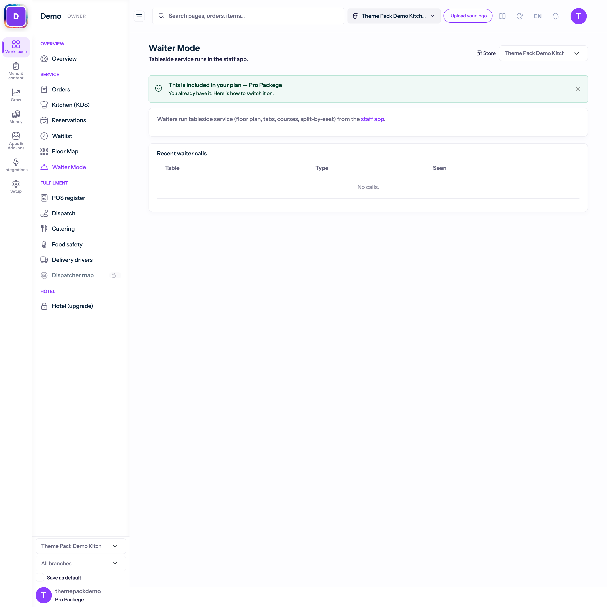

# Waiter mode



Waiter mode is the tableside service layer: waiters work an order at the table
— adding items to an open tab, holding and firing courses, splitting a bill by
seat, and merging two tables — and answer the "call waiter" and "request bill"
taps diners make from the QR menu.

The dashboard side of it is a single small **Waiter mode** console that shows
recent waiter calls. The actual tableside work happens in the [staff
app](staff-app.md).

## Opening the console

There is no sidebar link for this page. Open it directly at:

```
/waiter-mode
```

Use the store picker in the page's action bar to switch which restaurant you
are looking at. The page has no branch selector.

The console shows two things:

- A line pointing waiters at the staff app for the tableside work.
- **Recent waiter calls** — the newest 30 calls for the selected restaurant,
  with the **Table**, the **Type** (Call waiter or Request bill), and **Seen**
  (a tick once a waiter has acknowledged it, a dash otherwise).

This list is read-only. You cannot acknowledge a call from the dashboard; that
happens in the staff app.

## Where waiter calls come from

A diner raises a call from the storefront menu on their phone, so the button
only appears when:

- **Call waiter** is set to Yes on the restaurant's **Ordering** settings tab
  (edit the restaurant), and
- the diner is on an on-table (QR at the table) session.

Two types are recorded: `call_waiter` and `request_bill`. Each call stores the
table number and its seen flag — nothing about the diner.

## Tableside service in the staff app

Waiter mode's real surface is a set of staff-app endpoints under
`/staff-app/waiter/…`. Every one of them requires all of the following, or it
refuses:

- the staff member is signed in to the [staff app](staff-app.md);
- the store is allowed to use waiter mode (see [Turning it on](#turning-it-on));
- the staff member has the **orders** permission (see [Staff](staff.md)).

What the tableside layer does:

- **Floor status** — every table with an open order, and a derived state:
  `seated` (order but no items), `ordered`, `food_ready` (every item ready or
  served), or `check_requested` (the order is bill-requested or held).
- **Add items to an open order** — item, quantity, seat number (1–99) and
  course number (1–9) per line, with an optional **hold** flag. Sold-out (86'd)
  items and items from another restaurant are skipped rather than added.
  Prices are never entered by the waiter; the order total is always derived
  from the menu.
- **Fire a course** — held items of that course number enter the kitchen queue
  and get a fired timestamp. Until fired, a held item sits on the order but
  never reaches the [KDS](kds.md).
- **Split by seat** — returns a per-seat subtotal built from the menu price of
  each item, using the seat number recorded on the line. Items with no seat
  fall into seat 0.
- **Merge two tables** — moves every item from one open order into another
  order in the same restaurant. The source order is cancelled and stamped with
  a "merged into #N" note, so the merge is traceable.
- **Waiter calls** — lists the unseen calls, and marks one as seen.

Note: these behaviours are built and gated, but the staff-app screens do not
yet render a waiter tab. Today the staff PWA surfaces orders, the floor view,
tableside order creation, the kitchen view, checklists and messages — the
waiter-mode endpoints above are reachable but have no button of their own yet.

## Turning it on

Waiter mode is a gated feature. It runs only when both of these hold:

- the platform kill-switch for `waiter_mode` is on (a superadmin setting — it
  ships **off** by default), and
- the store owner's plan includes it (`waiter_mode` is plan-gated; check your
  plan's feature list).

If either check fails, the console page is blocked and every staff-app waiter
endpoint returns 403. See [Plans and billing](plans-billing.md).

## Related pages

- [Staff app](staff-app.md) — how staff sign in, and the floor and kitchen views.
- [Floor map and tables](floor-map.md) — the dining-room layout the table numbers come from.
- [Kitchen display system (KDS)](kds.md) — where fired courses land.
- [Split bill](split-bill.md) — the dashboard-side bill splitting.
- [Staff](staff.md) — the **orders** permission waiter mode requires.
