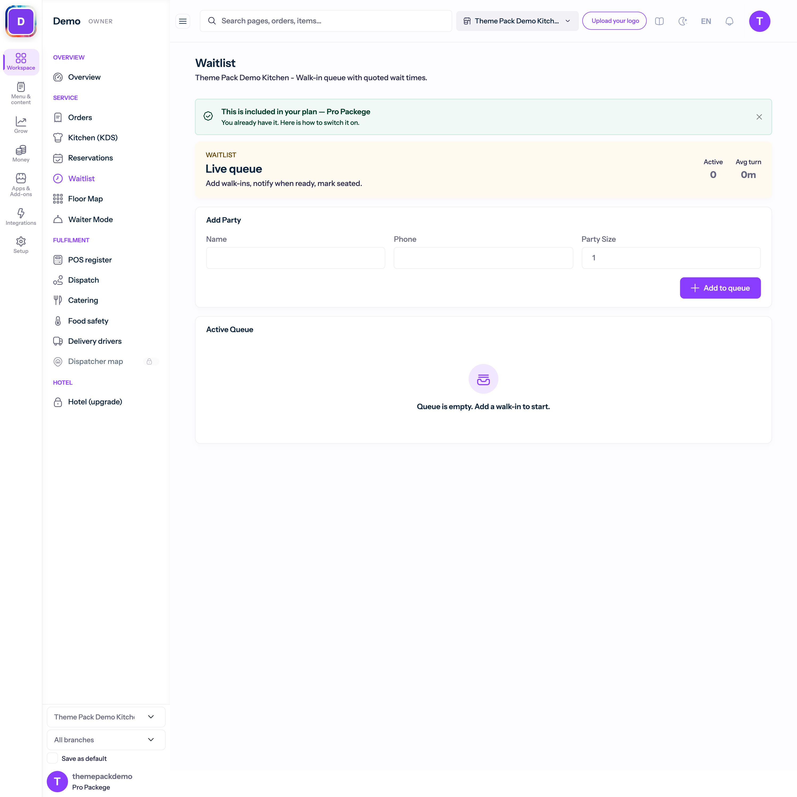

# Waitlist

When your dining room is full, the waitlist lets you add walk-in parties to a queue, give each one an estimated wait, text them when their table is ready, and mark them seated or gone. It replaces the paper list at the host stand.

## Where to find it

In the dashboard sidebar, open **Waitlist** (the clock icon). The link appears once you have at least one restaurant, and it opens the queue for your first restaurant. Each restaurant keeps its own separate waitlist.

The page has four parts: a live count strip at the top, an **Add party** form, the **Active queue** table, and a **Recent history** table below it.

## Adding a walk-in party

Fill in the **Add party** form and choose **Add to queue**:

- **Name** — required, up to 120 characters.
- **Phone** — optional, up to 30 characters. Add it if you want to text the guest when their table is ready.
- **Party size** — required, a number from 1 to 99.

The new party joins the bottom of the queue with the status **waiting**. The system stores a quoted wait time for them right away (see below).

## How the wait estimate works

Each party's quoted wait is a simple estimate: their position in the queue multiplied by an average table-turn time. The average turn time defaults to **20 minutes**, and the top strip shows the value currently in use as **Avg turn**.

The estimate is deliberately approximate. It is calculated once, when the party is added, from how many parties are already waiting ahead of them. It does not recalculate automatically as the queue moves, so treat the quoted number as a rough guide rather than a promise.

## Managing the queue

The **Active queue** table lists every party that is still **waiting** or **notified**, ordered by when they joined (oldest first). The **#** column is their live position. For each party you have these actions:

- **Notify** — shown only while a party is still **waiting**. Tells the guest their table is ready (details below).
- **Seat** — marks the party **seated** and removes them from the active queue.
- **Left** — marks the party **left** (walked off or no-show) and removes them from the active queue.

Seated and left parties drop out of the active list and move into **Recent history**, which shows the 50 most recent, newest first.

## Notifying a guest that their table is ready

Choosing **Notify** on a waiting party does two things:

1. If the party gave a phone number, it sends them a text: their name, your restaurant's name, and a note to come to the host stand.
2. It changes their status to **notified** and records the time.

A few things to know:

- **No phone number** is fine. The party is still marked **notified**; there is just no text to send, so call their name at the stand.
- **Opt-outs are respected.** If the guest's number has opted out of your texts, no message is sent and the party stays **waiting** with a note asking you to call them by name instead. This uses the same opt-out list as your other SMS.
- **Texting uses your SMS setup.** Table-ready texts go through the same SMS service as your order and one-time-code messages, so they use your configured SMS credentials. If you have not connected a live SMS provider, the send is simulated and logged rather than actually delivered — the status still updates so the workflow works, but the guest will not receive a real text until a live provider key is in place. See [WhatsApp and SMS](whatsapp.md).

## Letting guests join from their phone

Some public menu themes (the Aurora storefront) can show a **Join Waitlist** button so guests add themselves without a host. The form asks for name, party size, and an optional phone number for the text notification, then confirms their position and estimated wait on screen. Parties who join this way land in the same **Active queue** you manage from the dashboard.

This public button only appears when the waitlist is enabled for that storefront and the theme supports it, so it may not be available on your current theme. The public form is rate limited to guard against spam.

## Statuses at a glance

- **waiting** — in the queue, not yet called.
- **notified** — told their table is ready.
- **seated** — sat down; moved to history.
- **left** — walked off or no-show; moved to history.

## Related

- [Reservations](reservations.md) — booked tables ahead of time, as opposed to walk-ins.
- [Floor map](floor-map.md) — see which tables are open before you seat a party.
- [WhatsApp and SMS](whatsapp.md) — set up the provider that sends table-ready texts.

## Notes and limits

- The waitlist is per restaurant and only the owner (and dashboard staff) can manage it.
- The average turn time behind the wait estimate is stored per restaurant, but there is currently no settings screen to change it in the dashboard, so in practice it stays at the default 20 minutes unless set another way.
