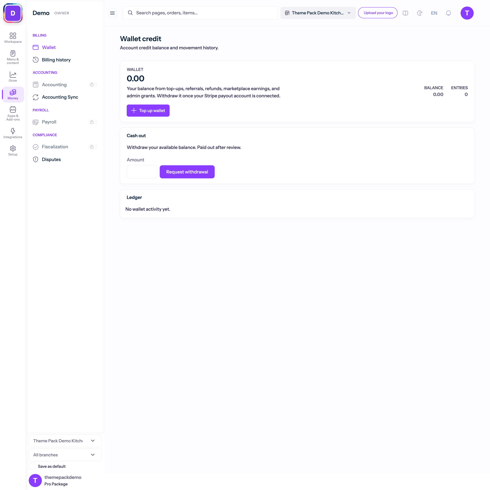

# Wallet and credits

Your wallet is a credit balance on your platform account — store credit you
can spend on add-ons, themes, and subscription renewals. It is money you hold
with the platform, not restaurant revenue: payments your customers make for
orders go through your own payment gateways and never land here.

Every movement in or out of the wallet is recorded in a ledger, so the
balance is always the exact sum of its history.

## Opening the wallet

Click **Wallet** in the dashboard sidebar (wallet icon). The page lives at
`/wallet` and shows:

- your current **balance** in the header strip
- a **Top up wallet** button (when self-service top-up is enabled)
- a **Cash out** card for withdrawing marketplace earnings
- the **Ledger** — your most recent 30 wallet movements

## Where credit comes from

Credit is added to your wallet by:

- **Top-ups** — you pay through a payment gateway and the amount is credited
  (see below).
- **Platform grants** — the platform team can add credit to your account,
  for example as a goodwill gesture or promo.
- **Marketplace earnings** — if you sell themes on the platform marketplace,
  your share of each sale is paid into the wallet.
- **Returned withdrawals** — if a cash-out request is rejected, the amount
  goes straight back to your balance.

Referral rewards are reviewed and paid out by the platform team — see
[Referral program](referrals.md) for how those work.

## Topping up

1. On the wallet page, click **Top up wallet**.
2. Pick one of the preset amounts, or type a **custom amount**. The form
   shows the allowed minimum and maximum; amounts outside that range are
   rejected.
3. Choose a **payment method** from the enabled gateways.
4. Click **Top Up**. You are redirected to the payment page to complete
   the charge.

Credit is added the moment the payment is confirmed by the gateway — never
before. A confirmed top-up can only be credited once, even if the payment
provider sends duplicate confirmations.

The minimum, maximum, and preset amounts are set by the platform (typical
defaults: minimum 5, maximum 1,000, presets 10 / 25 / 50 / 100, in the
platform currency). The platform can also turn self-service top-up off
entirely, in which case the button does not appear.

Top-up payments show up in two places: as a **credit** row in the wallet
ledger, and as a "Wallet top-up" payment on your **Billing history** page
(`/transactions`), where you can view and download the invoice. See
[Plans and billing](plans-billing.md) for more on that page.

## What you can spend it on

- **Add-ons** — one-time capacity packs can be paid from the wallet at the
  add-on checkout (the wallet option is disabled if your balance does not
  cover the price).
- **Add-on subscriptions** — monthly add-ons can be funded from the wallet
  and renew automatically (next section).
- **Plan renewals** — your main subscription can auto-renew from the wallet
  (next section).
- **Marketplace themes** — paid themes are bought with wallet credit.
- **Usage charges** — some metered features (for example platform-billed
  WhatsApp messages) charge the wallet per use.

You can never spend more than your balance; any charge that would take the
wallet negative is refused.

## Auto-renew from wallet

### Plan subscription

If wallet auto-renew is enabled on your account, the platform's hourly
billing run charges your renewal price to the wallet when your subscription
period ends, and your plan continues without interruption. Each period is
charged exactly once.

If the balance is too low, the renewal is skipped and the subscription goes
**past due** with a grace period (3 days by default, set by the platform)
before it expires. You get reminder emails before expiry (7, 3, and 1 day
out), on the expiry day, and partway through grace — so a quick top-up
during grace followed by renewal keeps you on your plan.

Wallet auto-renew for the main plan is opt-in and is currently enabled per
account by the platform team — there is no self-service switch in the
dashboard yet. Ask the platform admin if you want it turned on.

### Add-on subscriptions

For monthly add-ons you choose this yourself at checkout: pick **Monthly
(auto-renew)** as the billing mode and **Wallet** as the payment method.
The first month is charged immediately; after that, a daily run debits the
wallet shortly before each paid month ends and extends the add-on.

If the wallet cannot cover a renewal, the add-on is marked past due and you
get one email asking you to top up. Renewal is retried daily; if the add-on
stays unpaid for a week past its expiry, auto-renew is switched off and it
lapses. You can manage add-on subscriptions from the **Extensions** page.

## Reading the ledger

The **Ledger** card on the wallet page lists your latest 30 movements,
newest first. Each row shows:

- **When** — relative time of the entry.
- **Type** — a **credit** (money in, green badge) or **debit** (money out).
- **Note** — the reason, for example "Wallet top-up", "addon_purchase",
  "subscription_renewal", or "withdrawal".
- **Amount** — signed: credits show a leading `+`, debits are negative.

The ledger is append-only; entries are never edited or deleted, so the
balance always equals the sum of the rows.

## Cashing out marketplace earnings

If you have marketplace earnings in the wallet, the **Cash out** card lets
you request a withdrawal:

1. Enter an amount (up to your balance) and click **Request withdrawal**.
2. The amount is debited from the wallet immediately and held while the
   platform reviews the request. Requests above your balance are refused.
3. Approved withdrawals are paid out; rejected ones are credited straight
   back to the wallet.

When the platform has Stripe payouts enabled, a **Connect Stripe for
payouts** button appears — a one-time onboarding with Stripe so approved
withdrawals go directly to your bank account. You can resume an unfinished
onboarding at any time from the same card.

Your recent withdrawal requests and their statuses are listed under the
cash-out form.
