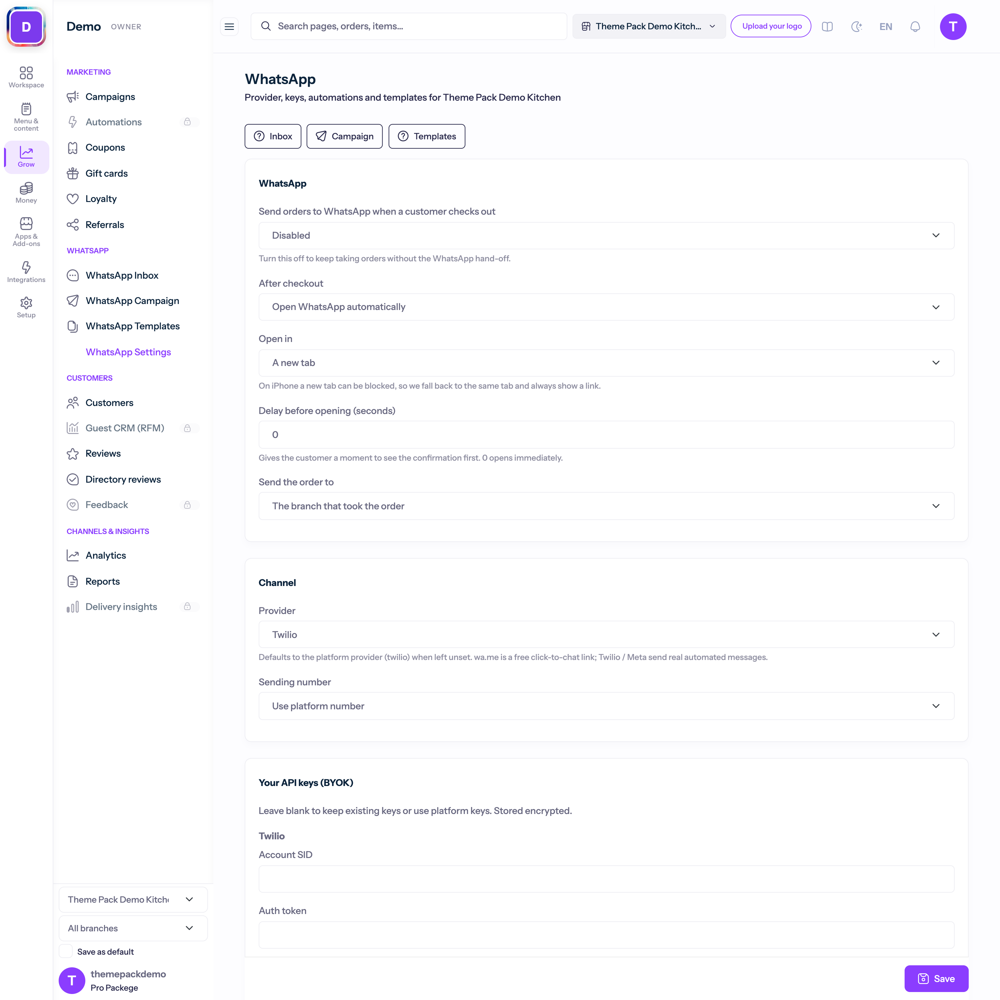

# WhatsApp

WhatsApp is a per-restaurant messaging channel. Customers can reach you by
chat, and you can send order confirmations, status updates, inbox replies, and
marketing broadcasts. Every restaurant has its own set of WhatsApp pages.

To open them, go to **Stores** in the sidebar and click the **WhatsApp**
button on a restaurant card. That opens the settings page for that restaurant.
The top of the settings page has buttons linking to the **Inbox**,
**Campaign**, and **Templates** pages for the same restaurant.

These pages belong to the restaurant owner account. Staff-dashboard users only
see the WhatsApp button when they have menu-edit access, and the pages
themselves are owner-only.

## Choosing a provider

On the settings page, the **Channel** card has a **Provider** dropdown with
three choices:

- **wa.me link (free)** — no API and no cost. Order buttons on your menu open a
  WhatsApp chat with your number and a pre-filled message; the customer taps
  send themselves. This is the built-in default and the guaranteed fallback:
  if a real provider fails or is not configured, the app degrades to a wa.me
  link so the customer can still reach you.
- **Twilio** — sends real automated messages through Twilio's WhatsApp API.
- **Meta Cloud API** — sends real automated messages through Meta's WhatsApp
  Cloud API.

If you leave the provider unset, the restaurant uses the platform's default
provider. The dropdown hint shows which provider that currently is.

Only Twilio and Meta can send automated messages (confirmations, status
updates, broadcasts, chatbot replies). The wa.me link carries no sending
identity, so it cannot do automations or broadcasts — it is click-to-chat only.

## Platform number vs your own keys (BYOK)

The **Sending number** dropdown chooses between:

- **Use platform number** — messages go through keys the platform provides.
- **Use my own number (BYOK)** — "bring your own keys": you supply your own
  Twilio or Meta credentials, and messages send from your own WhatsApp number.

Enter BYOK credentials in the **Your API keys (BYOK)** card:

- **Twilio** — Account SID, Auth Token, From number (e.g.
  `whatsapp:+14155238886`).
- **Meta Cloud API** — Access Token, Phone Number ID, App Secret, Webhook
  Verify Token.

Keys are stored encrypted. Leaving a field blank keeps the existing saved key
(or the platform key) — re-saving the form never wipes a stored secret. Once a
provider has keys saved, it counts as configured.

Meta requires a webhook so inbound messages and delivery receipts reach the
app. The Meta webhook URL is shown as a hint next to the Webhook Verify Token
field on the settings page; copy it into your Meta app configuration.

### Inbound message security — signing secret and sender registration

Inbound webhooks are **signature-verified and fail closed**: a message that
cannot be authenticated is rejected, it does not fall through. Two things must
both be true for messages on your own number to arrive:

1. **A signing secret is saved.** For Meta that is your **App Secret**; for
   Twilio your **Auth Token**. Without it, inbound messages on your own number
   are rejected outright.
2. **Your sending number is registered.** Saving the settings page registers
   your sender identity (Meta: the Phone Number ID; Twilio: the From number)
   so an inbound message can be matched to your restaurant before its
   signature is checked. If you set up BYOK before this system existed,
   **re-save the WhatsApp settings page once** to register your number —
   until you do, your inbound messages cannot be attributed to your store.

The **Your API keys (BYOK)** card shows the current state per provider:
"Inbound messages are signature-verified with your key" (green) when both are
in place, or a red warning telling you which of the two is missing — "No
signing secret saved…" or "Your sending number is not registered yet — save
this page once to register it."

Billing note: messages sent on your own keys (BYOK) and free wa.me links are
not metered by the platform. Only real API sends on the platform's keys count
against your plan or wallet.

## wa.me numbers and order message

The **WhatsApp Numbers (wa.me)** card lets you list up to ten WhatsApp numbers
and a default **wa.me Order Message**. These power the click-to-chat buttons on
your public menu regardless of which provider you selected, so customers always
have a way to message you.

Numbers are normalised for wa.me automatically: spaces, dashes, and a
`whatsapp:` prefix are stripped, and Arabic-Indic digits (٠-٩ / ۰-۹) are
converted to Latin digits — so a number typed with Arabic numerals works
rather than being silently emptied.

## Automations

The **Automations** card has three on/off settings and the template names they
use:

- **Send order confirmation on WhatsApp** — messages the customer when an order
  is placed. Uses the **Order confirmation template name** (e.g.
  `order_confirm`).
- **Send status updates on WhatsApp** — messages the customer when the order
  status changes. Uses the **Status update template name** (e.g.
  `order_status`).
- **AI chatbot auto-reply to inbound messages** — replies automatically to
  customer messages using the **Chatbot system prompt** you enter.

Automated messages sent outside the 24-hour customer window must use an
approved template. See "The 24-hour window" below and register your template
names on the [Templates](#templates) page.

There is also an abandoned-cart reminder that messages customers about unpaid
orders. It is controlled by a separate `customer_cart_whatsapp` setting and its
own cart template, and runs on an hourly schedule.

## Inbox

The **Inbox** page shows inbound WhatsApp messages for the restaurant, grouped
into one thread per customer, most recent first. Threads with messages you have
not answered show a "new" count badge.

Type a reply in a thread and press **Send** to answer inline. Replies go out as
in-window free service messages, and sending one marks that customer's
unanswered messages as handled. Inbox and delivery updates only work with a
real provider (Twilio or Meta) whose webhook is connected — a wa.me link cannot
receive replies into the app.

## Templates

WhatsApp requires pre-approved message templates to message customers outside
the 24-hour window. The **Templates** page is where you record the templates
you have already had approved on Twilio or Meta, so the app knows it can send
them.

For each template you enter:

- **Name** — must be lowercase letters, numbers, and underscores only (for
  example `order_confirm`).
- **Provider** — Meta or Twilio.
- **Language** — the template's language code.
- **Category** — Marketing, Utility, or Authentication.
- **Status** — Draft, Pending, Approved, or Rejected.
- **Body** — optional copy of the template text for your reference.

Saving reuses the row when the same provider, name, and language already exist,
so re-saving updates rather than duplicates. Use the remove action to delete a
template you no longer need.

Recording a template here does not create or submit it to Meta or Twilio — you
still get templates approved in your provider's own console. This page is a
registry of names the app is allowed to send.

## The 24-hour window

WhatsApp only lets businesses send free-form (non-template) messages within 24
hours of the customer's last inbound message. Inside that window a message is a
free service message; outside it, an approved template is required. The app
enforces this for real providers: if you try to send free-form text outside the
window, the send is skipped with a "requires template outside 24h window"
result. This is why your automation and campaign template names must match
approved templates.

## Campaigns (marketing broadcasts)

The **Campaign** page sends a marketing message to the restaurant's opted-in
audience. It shows the current **Opted-in audience** count — customers who
opted in and have not sent STOP. Compose a message, optionally name an approved
marketing template, and send. The message is queued to each recipient, spread
out to respect throughput limits, and opt-out and consent are re-checked for
every recipient at send time.

Two guardrails apply:

- Marketing needs an approved marketing template on Meta or Twilio.
- If your WhatsApp number's quality rating is low (flagged), campaigns are
  paused and you will see a message telling you to resolve the number's health
  before sending marketing. This protects the number from further damage.

For SMS and other channels, see [Campaigns](campaigns.md).

## Opt-out keywords

Customers control their marketing consent by replying to your WhatsApp number:

- **STOP**, **UNSUBSCRIBE**, **CANCEL**, or **QUIT** opts them out. They will no
  longer receive marketing broadcasts.
- **START**, **SUBSCRIBE**, **YES**, or **UNSTOP** opts them back in.

These keywords are matched automatically on inbound messages. Opted-out
customers are always skipped by campaigns, even if their number is later added
back to an audience.

## Data retention and privacy

Stored WhatsApp message bodies are automatically redacted after a retention
window (90 days by default). A daily cleanup keeps message counts and metadata
for billing and audit but strips the message text of older inbound threads and
outbound logs.

If a customer asks you to erase their data, the app can forget a contact: it
deletes their inbox threads, session window, and consent record, and redacts
their outbound message logs. Opt-out suppression is deliberately kept so a
forgotten number is not accidentally re-marketed later.

## Related pages

- [Campaigns](campaigns.md) — marketing across channels
- [Orders](orders.md) — order confirmations and status updates
- [AI agents](ai-agents.md) — automated chatbot behaviour
